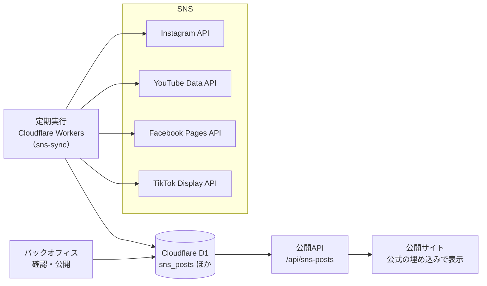

# ダイビング総合ポータルサイト SNS自動取り込み仕様書

| 項目 | 内容 |
|---|---|
| ドキュメント名 | SNS自動取り込み仕様書（Instagram・YouTube・Facebook・TikTok） |
| 版数 | v0.1（初版ドラフト） |
| 作成日 | 2026-11-24 |
| 対象 | 公開サイト `https://diving.link-since2026.jp` とバックオフィス |
| 関連資料 | `ダイビング総合ポータルサイト_仕様書.md`（F-08 動画・SNS埋め込み）、`データモデル定義書.md`、`バックオフィス仕様書.md` |

---

## 1. 概要

### 1.1 目的
運営者が Instagram・YouTube・Facebook・TikTok に投稿した内容を、**定期的に自動で取り込み、サイトに表示する**。
SNSに投稿するだけでサイトも更新される状態にして、二重の更新作業をなくす。

### 1.2 基本方針

| No. | 方針 | 理由 |
|---|---|---|
| P-1 | 取り込むのは **自分（運営者）のアカウントの投稿だけ** | 各SNSのAPIが、許可を得た本人のアカウントの投稿を前提にしているため |
| P-2 | 取り込むのは **本文・投稿日時・投稿のリンク・サムネイル** などの情報。**動画ファイルそのものはコピーしない** | 動画は各SNSの公式の埋め込みで表示する。著作権・ダウンロード制限への配慮と、保存容量・処理の負荷を避けるため |
| P-3 | 取り込んだ投稿は、初期設定では **「確認待ち」** にし、管理画面で確認してから公開する。SNSごとに「自動公開」にも切り替えられる | 意図しない投稿（告知の取り消し、私的な投稿など）がサイトに出るのを防ぐため |
| P-4 | 「投稿された瞬間」ではなく、**一定間隔で確認しに行く（定期実行）** | 自分の新規投稿を知らせる通知の仕組み（Webhook）が、各SNSに用意されていないか、限定的なため（2章） |
| P-5 | 各SNSの認証情報（アクセストークン）は **暗号化して保管** し、コードや GitHub に入れない | 漏えい時の被害を防ぐため |

### 1.3 用語

| 用語 | 意味 |
|---|---|
| 取り込み | SNSのAPIから投稿の情報を取得し、データベースに保存すること |
| 定期実行（バッチ） | 決まった時刻・間隔で、自動的に取り込みを動かすこと |
| アクセストークン | SNSが発行する「データを読んでよい」という許可証。期限がある |
| リフレッシュ | 期限が切れる前に、アクセストークンを新しくすること |
| 埋め込み | SNSが公式に提供する方法で、投稿や動画をサイト内に表示すること |

---

## 2. SNSごとの対応可否

| 項目 | Instagram | YouTube | Facebook | TikTok |
|---|---|---|---|---|
| 判定 | **可能** | **可能（いちばん簡単）** | **可能** | **可能（審査が必要）** |
| 必要なアカウント | プロアカウント（ビジネスまたはクリエイター） | YouTube チャンネル | **Facebookページ**（個人のプロフィールは不可） | TikTok アカウント |
| 開発者側の準備 | Meta の開発者アプリ | Google Cloud のプロジェクトと API キー | Meta の開発者アプリ | TikTok の開発者アカウントとアプリ。Login Kit と API の利用承認 |
| 使う API | Instagram API（Instagram ログイン方式） | YouTube Data API v3 | Graph API（Pages API） | Display API（TikTok API v2） |
| 認証 | アクセストークン（長期：60日） | API キー（期限なし） | ページのアクセストークン | アクセストークン（24時間）＋リフレッシュトークン（180日） |
| 取れる情報 | 本文、種類、投稿リンク、サムネイル、投稿日時 | タイトル、説明、動画ID、サムネイル、公開日時 | 本文、投稿リンク、画像、投稿日時 | タイトル・説明、投稿リンク、埋め込みリンク、カバー画像、投稿日時 |
| 新規投稿の通知 | なし（定期確認） | なし（定期確認） | なし（定期確認） | なし（定期確認） |
| 主な制限 | 動画ファイルのURLは返らないことがある | 1日の利用量の上限（10,000単位） | 取得できる投稿数に上限 | 公開動画のみ。返る件数が指定より少ないことがある |
| 推奨する確認間隔 | 1時間ごと | 1時間ごと | 1時間ごと | 1日2回 |

---

## 3. 全体の構成



| 部品 | 使うもの | 役割 |
|---|---|---|
| 定期実行 | Cloudflare Workers の Cron Trigger（Worker 名 `sns-sync`） | 決まった間隔で各SNSのAPIを呼び、新しい投稿を取り込む。Pages には定期実行の機能がないため、Worker を別に1つ作る |
| データベース | Cloudflare D1（`diving-site`） | 取り込んだ投稿、連携設定、実行履歴、暗号化したトークンを保存 |
| 管理画面 | バックオフィス | 連携の設定、確認待ちの投稿の公開・非公開、エラーの確認 |
| 公開API | Cloudflare Pages Functions | 公開済みの投稿を返す |
| 表示 | 各SNSの公式の埋め込み | 動画・投稿をサイト内に表示 |

---

## 4. 機能要件

| ID | 機能 | 内容 |
|---|---|---|
| S-01 | 定期取り込み | SNSごとに設定した間隔で、新しい投稿を取得する（初期値は2章の推奨間隔）。1回の実行で各SNSの最新20件程度を確認する |
| S-02 | 重複の防止と更新 | 「SNSの種類＋投稿ID」で同じ投稿かを判定する。新しい投稿は追加し、既存の投稿は本文やサムネイルの変更を反映する |
| S-03 | 取り込む投稿の選別 | SNSごとに「すべての投稿」か「特定のハッシュタグ（例：`#サイト掲載`）が付いた投稿だけ」かを選べる |
| S-04 | 公開のしかた | SNSごとに「確認してから公開（初期値）」か「自動で公開」かを選べる |
| S-05 | 表示場所の自動振り分け | ハッシュタグと、スポット・生き物・イベントの対応表を持ち、該当するページの関連動画欄に自動で表示する（例：`#慶良間` → スポット「慶良間諸島」）。管理画面で手動でも変更できる |
| S-06 | 表示 | 公式の埋め込みで表示する。埋め込みが使えない投稿は、サムネイル＋「Instagramで見る」などのリンクで表示する |
| S-07 | SNS側での削除・非公開への追随 | SNS側で削除・非公開になった投稿は、次の取り込みで検知し、サイトから外す（データは「削除済み」として残す） |
| S-08 | トークンの自動更新 | 期限が近づいたアクセストークンを自動でリフレッシュする（5章の各SNSの規則に従う）。更新に失敗したら管理者に通知する |
| S-09 | 実行履歴と通知 | 実行ごとに、取得件数・追加件数・エラーを記録する。同じSNSで3回続けて失敗したら、管理者にメールで知らせ、ダッシュボードに警告を出す |
| S-10 | 手動実行 | 管理画面の「今すぐ取り込む」で、定期実行を待たずに取り込める |
| S-11 | 一時停止 | SNSごとに取り込みを止められる（トークンの期限切れ時なども自動で停止する） |
| S-12 | 手動登録との共存 | 既存の手動登録（`embeds` テーブル）は残す。サイトでは、手動登録と自動取り込みの両方を、日付の新しい順にまとめて表示する |

### 4.1 取り込みの流れ（1回の実行）

1. 取り込みが有効になっているSNSアカウントを読み込む
2. トークンの期限を確認し、必要ならリフレッシュする
3. SNSのAPIから最新の投稿を取得する
4. 選別ルール（S-03）に合う投稿だけを残す
5. 新しい投稿は追加、既存の投稿は更新する。自動公開の設定なら「公開」、そうでなければ「確認待ち」にする
6. ハッシュタグの対応表で表示場所を振り分ける（S-05）
7. 実行履歴を記録する。公開した投稿があれば、公開サイトの表示用キャッシュを更新する

### 4.2 投稿の状態

| 状態 | 意味 | サイトに表示 |
|---|---|---|
| `pending` 確認待ち | 取り込んだが、まだ確認していない | しない |
| `published` 公開 | 確認済み、または自動公開 | する |
| `hidden` 非表示 | 運営者がサイトに出さないと決めた | しない |
| `removed` 削除済み | SNS側で削除・非公開になった | しない |

---

## 5. SNSごとの仕様

### 5.1 Instagram

**前提**
- Instagram をプロアカウント（ビジネスまたはクリエイター）にする。この API は、プロアカウントが持つ投稿のデータしか返さない
- Instagram ログイン方式の API を使う。この方式では、Facebookページとの連携は不要
- Meta の開発者アプリを作り、権限 `instagram_business_basic` を使う

**取得方法**
- 投稿の一覧：`GET https://graph.instagram.com/{バージョン}/me/media`
- 取得する項目：`id`、`caption`（本文）、`media_type`（IMAGE／VIDEO／CAROUSEL_ALBUM）、`media_product_type`（FEED／REELS など）、`permalink`（投稿のリンク）、`thumbnail_url`（動画のサムネイル）、`media_url`、`timestamp`（投稿日時）

**認証**
- 長期アクセストークン（有効期限60日）を使う
- リフレッシュは、発行から24時間以上たち、期限が切れていないトークンで行い、更新後は60日有効になる。60日間リフレッシュしないと期限切れになり、リフレッシュできなくなる
- 運用：**期限の30日前を過ぎたら、取り込みのついでに自動でリフレッシュする**

**注意**
- 動画（特に音楽付きのリール）は、ダウンロードや著作権の保護のため、`media_url`（動画ファイルのURL）が返らないことがある。その場合も、本文・投稿リンクなどは通常どおり返る。`media_url` は使わず、`permalink` での埋め込みを基本とする
- Instagram の Webhook は、コメント、メンション、ストーリーの分析、メッセージなどの通知が対象で、自分の新規投稿の通知はない
- `thumbnail_url` や `media_url` は一時的なURLのため、期間がたつと表示できなくなることがある。サムネイルを長く使う場合は、R2 にコピーして保存する（フェーズ S-2）
- 開発者アプリを「開発モード」のまま自分のアカウントだけで使えるか、アプリの審査が必要かは、準備時に確認する（未決事項 N-03）

**表示**：Instagram 公式の埋め込み（投稿のリンクから生成）

### 5.2 YouTube

**前提**
- YouTube チャンネルを持っていること
- Google Cloud でプロジェクトを作り、YouTube Data API v3 を有効にして、API キーを発行する（公開動画を読むだけなので、ログイン認証は不要）

**取得方法**
1. 最初の1回だけ：`channels.list`（`part=contentDetails`）で、チャンネルの「アップロード動画」の再生リストIDを調べて保存する
2. 毎回：`playlistItems.list`（再生リストID、`part=snippet,contentDetails`、`maxResults=20`）で最新の動画を取得する
3. 新しい動画があれば：`videos.list`（`part=snippet,contentDetails,status`）で、長さ・公開状態などを取得する（ショート動画の判定にも使う）

**利用量（クォータ）**
- 1日の上限は 10,000 単位（すべてのメソッドの合計。米国太平洋時間の0時にリセット）
- `playlistItems.list` は1回1単位。1時間ごとに実行しても、1日あたり数十単位で収まる
- **`search.list`（検索）は1回100単位と重いので使わない**

**認証**：API キー。期限はないが、Cloudflare の秘密情報（Secrets）として保管し、使えるサイトや API を Google Cloud 側で制限する

**補助の方法**：YouTube がチャンネルごとに提供する RSS（`https://www.youtube.com/feeds/videos.xml?channel_id=…`）でも、最新の動画の一覧を API キーなしで取得できる。API キーの準備前の仮運用や、API が使えないときの代替として使える

**表示**：YouTube 公式の埋め込みプレーヤー。プライバシー強化モード（`youtube-nocookie.com`）を使う

### 5.3 Facebook

**前提**
- **Facebookページ** を持っていること（個人のプロフィールの投稿は対象外）
- Meta の開発者アプリを作り、Facebook ログインでページのアクセストークンを取得する
- 権限：`pages_show_list`（管理しているページの一覧）、`pages_read_engagement`（ページの投稿の読み取り）
- トークンを発行する人は、ページの管理権限を持っていること

**取得方法**
- 投稿の一覧：`GET https://graph.facebook.com/{バージョン}/{ページID}/published_posts`
- 取得する項目：`id`、`message`（本文）、`created_time`（投稿日時）、`permalink_url`（投稿のリンク）、`full_picture`（画像）、`attachments`（添付の動画・画像の情報）、`is_published`
- 動画を多く投稿する場合は、`/{ページID}/videos` も合わせて取得する

**制限**
- フィードの取得では、1年あたりおおむね600件までの投稿が返る。この用途では問題にならない
- 期限切れになった投稿は、API で内容を取得できない

**認証**：ページのアクセストークン。長期のユーザートークンから取得したページトークンを使う。期限と更新方法は、準備時に確認する（未決事項 N-04）

**表示**：Facebook 公式の埋め込み（投稿・動画の埋め込み）

### 5.4 TikTok

**前提**
- TikTok の開発者ポータルで開発者アカウントとアプリを作り、**Login Kit と TikTok API（Display API）の利用承認を受ける**
- 権限（スコープ）：`user.info.basic`（プロフィール）、`video.list`（自分の公開動画の読み取り）
- 運営者の TikTok アカウントで一度ログインして許可し、トークンを取得する

**取得方法**
- 動画の一覧：`POST https://open.tiktokapis.com/v2/video/list/`（作成日時の新しい順に、公開動画を返す）
- 取得する項目：`id`、`title`、`video_description`、`create_time`、`cover_image_url`、`share_url`、`embed_link`、`duration`

**認証**
- アクセストークンは24時間で期限切れになる。リフレッシュトークンで、利用者の再操作なしに更新できる
- リフレッシュトークンの期限は、最初の発行から180日。リフレッシュするたびに新しいリフレッシュトークンが発行され、古いものはすぐに無効になるため、**毎回、最新のリフレッシュトークンを保存し直す**
- 運用：**取り込みのたびにアクセストークンをリフレッシュする**。180日を過ぎる前に、管理画面から再度ログインして許可し直す（期限の14日前から警告を出す）

**注意**
- TikTok の安全上の方針により、次の動画があっても、指定した件数より少なく返ることがある。取りこぼしを防ぐため、毎回の確認件数に余裕を持たせる
- 公開動画のみが対象

**表示**：TikTok 公式の埋め込み（`embed_link`、または投稿のリンクから生成）

---

## 6. データモデル（追加するテーブル）

`データモデル定義書.md` の共通ルール（共通列、日時・金額の扱い、論理削除）に従う。SQL は付録Aに記載する。

### 6.1 テーブル一覧

| テーブル | 論理名 | 内容 |
|---|---|---|
| `sns_accounts` | SNS連携アカウント | 連携するSNSアカウントと、取り込みの設定 |
| `sns_credentials` | SNS認証情報 | 暗号化したアクセストークン・リフレッシュトークンと期限 |
| `sns_posts` | 取り込んだ投稿 | 投稿の情報と公開状態 |
| `sns_post_places` | 投稿の表示場所 | 投稿をどのページに出すか |
| `sns_tag_rules` | ハッシュタグの振り分けルール | ハッシュタグとページの対応 |
| `sns_sync_runs` | 取り込みの実行履歴 | 実行ごとの結果と件数、エラー |

### 6.2 テーブル定義

共通列（`id`、`created_at`、`updated_at`、`updated_by`）は省略する。

#### `sns_accounts`（SNS連携アカウント）
| 列 | 論理名 | 型 | 必須 | 説明・制約 |
|---|---|---|---|---|
| `platform` | SNSの種類 | TEXT | ○ | `instagram`／`youtube`／`facebook`／`tiktok` |
| `display_name` | 表示名 | TEXT | ○ | アカウント名やチャンネル名 |
| `external_account_id` | SNS側のID | TEXT | ○ | Instagram のユーザーID、YouTube のチャンネルID、Facebook のページID、TikTok の open_id |
| `uploads_playlist_id` | アップロード動画の再生リストID | TEXT | | YouTube のみ |
| `profile_url` | アカウントのURL | TEXT | | |
| `sync_enabled` | 取り込み有効 | INTEGER（0/1） | ○ | |
| `sync_interval_min` | 確認間隔（分） | INTEGER | ○ | 60、720 など |
| `import_rule` | 取り込む投稿 | TEXT | ○ | `all`（すべて）／`hashtag`（ハッシュタグ付きのみ） |
| `import_hashtag` | 取り込み用ハッシュタグ | TEXT | | `import_rule = 'hashtag'` のとき必須。`#` なしで保存 |
| `auto_publish` | 自動公開 | INTEGER（0/1） | ○ | 初期値 0（確認してから公開） |
| `last_synced_at` | 最終取り込み日時 | TEXT | | |
| `last_result` | 最終結果 | TEXT | | `success`／`failed` |
| `consecutive_failures` | 連続失敗回数 | INTEGER | ○ | 3回で通知 |
| `status` | 状態 | TEXT | ○ | `active`（連携中）／`paused`（一時停止）／`reauth_required`（再ログインが必要） |

一意制約：（`platform`、`external_account_id`）

#### `sns_credentials`（SNS認証情報）
**管理画面にも中身を表示しない。読み書きは定期実行のプログラムだけが行う。**
| 列 | 論理名 | 型 | 必須 | 説明・制約 |
|---|---|---|---|---|
| `account_id` | 連携アカウント | INTEGER | ○ | → `sns_accounts.id`。一意 |
| `access_token_enc` | アクセストークン（暗号化） | TEXT | | YouTube は API キーを Secrets に置くため空 |
| `refresh_token_enc` | リフレッシュトークン（暗号化） | TEXT | | TikTok のみ |
| `access_expires_at` | アクセストークンの期限 | TEXT | | |
| `refresh_expires_at` | リフレッシュトークンの期限 | TEXT | | TikTok のみ |
| `last_refreshed_at` | 最終リフレッシュ日時 | TEXT | | |
| `key_version` | 暗号鍵の版 | INTEGER | ○ | 鍵を入れ替えたときの判別用 |

暗号化：AES-GCM。鍵は Cloudflare の Secrets（`SNS_TOKEN_KEY`）に置き、データベースには置かない。

#### `sns_posts`（取り込んだ投稿）
| 列 | 論理名 | 型 | 必須 | 説明・制約 |
|---|---|---|---|---|
| `account_id` | 連携アカウント | INTEGER | ○ | → `sns_accounts.id` |
| `platform` | SNSの種類 | TEXT | ○ | 検索を速くするため、アカウントから複製して持つ |
| `external_id` | SNS側の投稿ID | TEXT | ○ | |
| `post_type` | 種類 | TEXT | ○ | `image`／`video`／`reel`／`short`／`carousel`／`text` |
| `title` | タイトル | TEXT | | YouTube、TikTok |
| `caption` | 本文・説明 | TEXT | | |
| `hashtags` | ハッシュタグ | TEXT（JSON配列） | | 本文から抜き出したもの（`#` なし） |
| `permalink` | 投稿のリンク | TEXT | ○ | |
| `embed_url` | 埋め込み用URL | TEXT | | YouTube の埋め込みURL、TikTok の `embed_link` など |
| `thumbnail_url` | サムネイルのURL | TEXT | | SNS側のURL（一時的な場合がある） |
| `thumbnail_media_id` | 保存したサムネイル | INTEGER | | → `media.id`（R2 に保存した場合） |
| `duration_sec` | 長さ（秒） | INTEGER | | 動画のみ |
| `posted_at` | 投稿日時 | TEXT | ○ | |
| `review_status` | 状態 | TEXT | ○ | `pending`／`published`／`hidden`／`removed`（4.2） |
| `reviewed_by` | 確認した人 | TEXT | | |
| `reviewed_at` | 確認日時 | TEXT | | |
| `first_seen_at` | 初めて取り込んだ日時 | TEXT | ○ | |
| `last_seen_at` | 最後にSNS側で確認できた日時 | TEXT | ○ | 削除の検知に使う |
| `raw_json` | 取得した元データ | TEXT（JSON） | | 調査用。表示には使わない |

一意制約：（`platform`、`external_id`）

#### `sns_post_places`（投稿の表示場所）
| 列 | 論理名 | 型 | 必須 | 説明・制約 |
|---|---|---|---|---|
| `post_id` | 投稿 | INTEGER | ○ | → `sns_posts.id` |
| `place_kind` | 表示する場所 | TEXT | ○ | `top`／`spot`／`creature`／`event`／`post`／`media_page`（動画・SNSページ） |
| `place_id` | 場所のID | INTEGER | | `top` と `media_page` のときは空 |
| `assigned_by` | 振り分けの方法 | TEXT | ○ | `rule`（自動）／`manual`（手動） |

一意制約：（`post_id`、`place_kind`、`place_id`）

#### `sns_tag_rules`（ハッシュタグの振り分けルール）
| 列 | 論理名 | 型 | 必須 | 説明・制約 |
|---|---|---|---|---|
| `hashtag` | ハッシュタグ | TEXT | ○ | `#` なし。大文字・小文字は区別しない |
| `place_kind` | 表示する場所 | TEXT | ○ | `sns_post_places.place_kind` と同じ値 |
| `place_id` | 場所のID | INTEGER | | |
| `active` | 有効 | INTEGER（0/1） | ○ | |

一意制約：（`hashtag`、`place_kind`、`place_id`）

#### `sns_sync_runs`（取り込みの実行履歴）
| 列 | 論理名 | 型 | 必須 | 説明・制約 |
|---|---|---|---|---|
| `account_id` | 連携アカウント | INTEGER | ○ | → `sns_accounts.id` |
| `trigger` | 起動のしかた | TEXT | ○ | `cron`（定期）／`manual`（手動） |
| `started_at` | 開始日時 | TEXT | ○ | |
| `finished_at` | 終了日時 | TEXT | | |
| `result` | 結果 | TEXT | ○ | `running`／`success`／`failed` |
| `fetched_count` | 取得件数 | INTEGER | ○ | |
| `inserted_count` | 追加件数 | INTEGER | ○ | |
| `updated_count` | 更新件数 | INTEGER | ○ | |
| `removed_count` | 削除検知件数 | INTEGER | ○ | |
| `error_message` | エラー内容 | TEXT | | トークンなどの秘密情報は書かない |

保存期間：90日を過ぎた履歴は自動で削除する。

---

## 7. 公開API

| メソッド | パス | 返すもの |
|---|---|---|
| GET | `/api/sns-posts?place=top` | トップに出す公開済みの投稿（手動登録の `embeds` と合わせ、新しい順） |
| GET | `/api/sns-posts?place=spot&id=12` | スポット「12」の関連動画 |
| GET | `/api/sns-posts?platform=youtube&limit=12` | SNSごとの一覧（動画・SNSページ用） |

- `review_status = 'published'` の投稿だけを返す。`raw_json` や認証情報は返さない
- 結果は短時間（例：5分）キャッシュし、データベースの読み取りを抑える

---

## 8. バックオフィスの追加画面

| ID | 画面 | 機能 | 権限 |
|---|---|---|---|
| BO-90 | SNS連携の設定 | SNSごとの連携（ログインして許可する／API キーを登録する）、確認間隔、取り込む投稿の選別、自動公開の切り替え、一時停止、「今すぐ取り込む」。トークンの期限と残り日数を表示 | owner |
| BO-91 | 取り込んだ投稿 | 確認待ちの一覧（埋め込みのプレビュー付き）。公開・非表示の切り替え、表示場所の変更、まとめて公開 | 全員 |
| BO-92 | ハッシュタグの振り分け | ハッシュタグとスポット・生き物・イベントの対応表の編集 | 全員 |
| BO-93 | 取り込みの履歴 | 実行ごとの結果・件数・エラー | owner |

ダッシュボード（BO-01）に、次を追加する。
- 確認待ちの投稿の件数
- トークンの期限が近い連携（Instagram：残り14日以内、TikTok：リフレッシュトークンの残り14日以内）
- 連続で失敗している連携

---

## 9. 非機能要件

| 区分 | 要件 |
|---|---|
| 費用 | Cloudflare の無料プランの範囲で動かす。定期実行（Cron Trigger）は無料プランでアカウントあたり5個まで使えるため、**1つの Cron（例：毎時0分）で動かし、プログラムの中でSNSごとの間隔を判定する** |
| 処理の軽さ | 無料プランは、1回の実行で外部に問い合わせられる回数が50回まで、CPU時間が10ミリ秒まで。1回の実行で扱うSNSアカウントと件数を絞り、動画のダウンロードや画像の変換は行わない |
| 安全性 | トークンは暗号化して保存する。API キーと暗号鍵は Cloudflare の Secrets に置く。エラー内容や履歴にトークンを書かない。連携の追加・解除は owner だけが行える |
| 規約の順守 | 各SNSの開発者規約と、表示に関するルール（公式の埋め込みを使う、投稿者名やリンクを残すなど）に従う。動画ファイルの複製・再配布はしない |
| 個人情報 | コメントや「いいね」をした人など、ほかの利用者の情報は取り込まない |
| 障害時の影響 | 取り込みが失敗しても、すでに公開している投稿の表示は続ける。SNSのAPIが一時的に使えない場合は、次回の実行で自動的に取り込みし直す |
| 仕様変更への備え | 各SNSのAPIのバージョンは設定値として持ち、変更に対応しやすくする。APIの変更や終了の告知を、半年に1回確認する |

---

## 10. 段階的なリリース

| フェーズ | 対象 | 理由 |
|---|---|---|
| S-1 | **YouTube**、**Instagram** | YouTube は API キーだけで始められ、もっとも簡単。Instagram は利用頻度が高い |
| S-2 | **Facebook**、サムネイルの R2 保存 | Instagram と同じ Meta の開発者アプリで準備できる。R2 はバックオフィスの BO-2 と合わせて有効化する |
| S-3 | **TikTok** | 開発者アプリの利用承認（審査）が必要で、準備に時間がかかるため |

前提：バックオフィスの BO-1（ログイン・ダッシュボード）とデータベースが動いていること。

---

## 11. 運営者が行う準備

| SNS | 運営者が行うこと |
|---|---|
| 共通 | 取り込み用の Worker（`sns-sync`）を Cloudflare に作り、データベース `diving-site` とつなぐ。暗号鍵（`SNS_TOKEN_KEY`）を Secrets に登録する |
| YouTube | ① Google Cloud でプロジェクトを作る ② YouTube Data API v3 を有効にする ③ API キーを作り、使える API を YouTube Data API v3 に制限する ④ チャンネルID を確認する |
| Instagram | ① Instagram をプロアカウントに切り替える ② Meta の開発者アカウントとアプリを作る ③ Instagram ログインの設定をする ④ バックオフィスの BO-90 から、Instagram でログインして許可する |
| Facebook | ① Facebookページを用意する ② Meta の開発者アプリに Facebook ログインを追加する ③ BO-90 から Facebook でログインし、対象のページを選んで許可する |
| TikTok | ① TikTok の開発者アカウントを作る ② アプリを作り、Login Kit と Display API を申請する（審査） ③ 承認後、BO-90 から TikTok でログインして許可する |

---

## 12. 未決事項

| No. | 内容 |
|---|---|
| N-01 | SNSごとの公開のしかた（確認してから公開／自動で公開） |
| N-02 | 取り込む投稿の選別（すべて／ハッシュタグ付きのみ）と、使うハッシュタグ |
| N-03 | Instagram：Meta の開発者アプリを開発モードのまま自分のアカウントだけで使えるか、アプリの審査が必要か |
| N-04 | Facebook：ページのアクセストークンの期限と更新方法の確認 |
| N-05 | 各SNSのアカウント名・チャンネルID・ページID |
| N-06 | 取り込みの通知メールの送信方法（`バックオフィス仕様書.md` B-02 と共通） |
| N-07 | 過去の投稿を何件までさかのぼって取り込むか（初回の取り込み） |

---

## 付録A 追加テーブルの SQL（SQLite／Cloudflare D1）

`migrations/0003_sns.sql` として、`0001_init.sql`・`0002_seed.sql` の後に実行する。

```sql
-- =====================================================================
-- SNS自動取り込み 追加テーブル（SQLite / Cloudflare D1）
-- 前提：0001_init.sql（と 0002_seed.sql）を実行済みであること
-- =====================================================================

CREATE TABLE sns_accounts (
  id                    INTEGER PRIMARY KEY,
  platform              TEXT    NOT NULL CHECK (platform IN ('instagram','youtube','facebook','tiktok')),
  display_name          TEXT    NOT NULL,
  external_account_id   TEXT    NOT NULL,
  uploads_playlist_id   TEXT,
  profile_url           TEXT,
  sync_enabled          INTEGER NOT NULL DEFAULT 1  CHECK (sync_enabled IN (0,1)),
  sync_interval_min     INTEGER NOT NULL DEFAULT 60 CHECK (sync_interval_min >= 15),
  import_rule           TEXT    NOT NULL DEFAULT 'all' CHECK (import_rule IN ('all','hashtag')),
  import_hashtag        TEXT,
  auto_publish          INTEGER NOT NULL DEFAULT 0  CHECK (auto_publish IN (0,1)),
  last_synced_at        TEXT,
  last_result           TEXT    CHECK (last_result IS NULL OR last_result IN ('success','failed')),
  consecutive_failures  INTEGER NOT NULL DEFAULT 0  CHECK (consecutive_failures >= 0),
  status                TEXT    NOT NULL DEFAULT 'active' CHECK (status IN ('active','paused','reauth_required')),
  created_at            TEXT    NOT NULL DEFAULT (strftime('%Y-%m-%dT%H:%M:%SZ','now')),
  updated_at            TEXT    NOT NULL DEFAULT (strftime('%Y-%m-%dT%H:%M:%SZ','now')),
  updated_by            TEXT,
  UNIQUE (platform, external_account_id),
  CHECK (import_rule = 'all' OR (import_hashtag IS NOT NULL AND length(import_hashtag) > 0))
) STRICT;

CREATE TABLE sns_credentials (
  id                  INTEGER PRIMARY KEY,
  account_id          INTEGER NOT NULL UNIQUE REFERENCES sns_accounts(id) ON DELETE CASCADE,
  access_token_enc    TEXT,
  refresh_token_enc   TEXT,
  access_expires_at   TEXT,
  refresh_expires_at  TEXT,
  last_refreshed_at   TEXT,
  key_version         INTEGER NOT NULL DEFAULT 1,
  created_at          TEXT    NOT NULL DEFAULT (strftime('%Y-%m-%dT%H:%M:%SZ','now')),
  updated_at          TEXT    NOT NULL DEFAULT (strftime('%Y-%m-%dT%H:%M:%SZ','now')),
  updated_by          TEXT
) STRICT;

CREATE TABLE sns_posts (
  id                  INTEGER PRIMARY KEY,
  account_id          INTEGER NOT NULL REFERENCES sns_accounts(id),
  platform            TEXT    NOT NULL CHECK (platform IN ('instagram','youtube','facebook','tiktok')),
  external_id         TEXT    NOT NULL,
  post_type           TEXT    NOT NULL CHECK (post_type IN ('image','video','reel','short','carousel','text')),
  title               TEXT,
  caption             TEXT,
  hashtags            TEXT    CHECK (hashtags IS NULL OR json_valid(hashtags)),
  permalink           TEXT    NOT NULL,
  embed_url           TEXT,
  thumbnail_url       TEXT,
  thumbnail_media_id  INTEGER REFERENCES media(id),
  duration_sec        INTEGER CHECK (duration_sec IS NULL OR duration_sec >= 0),
  posted_at           TEXT    NOT NULL,
  review_status       TEXT    NOT NULL DEFAULT 'pending' CHECK (review_status IN ('pending','published','hidden','removed')),
  reviewed_by         TEXT,
  reviewed_at         TEXT,
  first_seen_at       TEXT    NOT NULL DEFAULT (strftime('%Y-%m-%dT%H:%M:%SZ','now')),
  last_seen_at        TEXT    NOT NULL DEFAULT (strftime('%Y-%m-%dT%H:%M:%SZ','now')),
  raw_json            TEXT    CHECK (raw_json IS NULL OR json_valid(raw_json)),
  created_at          TEXT    NOT NULL DEFAULT (strftime('%Y-%m-%dT%H:%M:%SZ','now')),
  updated_at          TEXT    NOT NULL DEFAULT (strftime('%Y-%m-%dT%H:%M:%SZ','now')),
  updated_by          TEXT,
  UNIQUE (platform, external_id)
) STRICT;
CREATE INDEX idx_sns_posts_status_posted ON sns_posts (review_status, posted_at);
CREATE INDEX idx_sns_posts_account       ON sns_posts (account_id, posted_at);

CREATE TABLE sns_post_places (
  id           INTEGER PRIMARY KEY,
  post_id      INTEGER NOT NULL REFERENCES sns_posts(id) ON DELETE CASCADE,
  place_kind   TEXT    NOT NULL CHECK (place_kind IN ('top','spot','creature','event','post','media_page')),
  place_id     INTEGER,
  assigned_by  TEXT    NOT NULL DEFAULT 'rule' CHECK (assigned_by IN ('rule','manual')),
  created_at   TEXT    NOT NULL DEFAULT (strftime('%Y-%m-%dT%H:%M:%SZ','now')),
  updated_at   TEXT    NOT NULL DEFAULT (strftime('%Y-%m-%dT%H:%M:%SZ','now')),
  updated_by   TEXT,
  UNIQUE (post_id, place_kind, place_id),
  CHECK ((place_kind IN ('top','media_page')) = (place_id IS NULL))
) STRICT;
CREATE INDEX idx_sns_post_places_place ON sns_post_places (place_kind, place_id);

CREATE TABLE sns_tag_rules (
  id          INTEGER PRIMARY KEY,
  hashtag     TEXT    NOT NULL COLLATE NOCASE,
  place_kind  TEXT    NOT NULL CHECK (place_kind IN ('top','spot','creature','event','post','media_page')),
  place_id    INTEGER,
  active      INTEGER NOT NULL DEFAULT 1 CHECK (active IN (0,1)),
  created_at  TEXT    NOT NULL DEFAULT (strftime('%Y-%m-%dT%H:%M:%SZ','now')),
  updated_at  TEXT    NOT NULL DEFAULT (strftime('%Y-%m-%dT%H:%M:%SZ','now')),
  updated_by  TEXT,
  UNIQUE (hashtag, place_kind, place_id),
  CHECK ((place_kind IN ('top','media_page')) = (place_id IS NULL))
) STRICT;

CREATE TABLE sns_sync_runs (
  id              INTEGER PRIMARY KEY,
  account_id      INTEGER NOT NULL REFERENCES sns_accounts(id) ON DELETE CASCADE,
  "trigger"       TEXT    NOT NULL CHECK ("trigger" IN ('cron','manual')),
  started_at      TEXT    NOT NULL DEFAULT (strftime('%Y-%m-%dT%H:%M:%SZ','now')),
  finished_at     TEXT,
  result          TEXT    NOT NULL DEFAULT 'running' CHECK (result IN ('running','success','failed')),
  fetched_count   INTEGER NOT NULL DEFAULT 0 CHECK (fetched_count  >= 0),
  inserted_count  INTEGER NOT NULL DEFAULT 0 CHECK (inserted_count >= 0),
  updated_count   INTEGER NOT NULL DEFAULT 0 CHECK (updated_count  >= 0),
  removed_count   INTEGER NOT NULL DEFAULT 0 CHECK (removed_count  >= 0),
  error_message   TEXT,
  created_at      TEXT    NOT NULL DEFAULT (strftime('%Y-%m-%dT%H:%M:%SZ','now')),
  updated_at      TEXT    NOT NULL DEFAULT (strftime('%Y-%m-%dT%H:%M:%SZ','now')),
  updated_by      TEXT
) STRICT;
CREATE INDEX idx_sns_sync_runs_account ON sns_sync_runs (account_id, started_at);

-- updated_at の自動更新
CREATE TRIGGER trg_sns_accounts_updated_at AFTER UPDATE ON sns_accounts
FOR EACH ROW WHEN NEW.updated_at = OLD.updated_at
BEGIN
  UPDATE sns_accounts SET updated_at = strftime('%Y-%m-%dT%H:%M:%SZ','now') WHERE id = NEW.id;
END;
CREATE TRIGGER trg_sns_credentials_updated_at AFTER UPDATE ON sns_credentials
FOR EACH ROW WHEN NEW.updated_at = OLD.updated_at
BEGIN
  UPDATE sns_credentials SET updated_at = strftime('%Y-%m-%dT%H:%M:%SZ','now') WHERE id = NEW.id;
END;
CREATE TRIGGER trg_sns_posts_updated_at AFTER UPDATE ON sns_posts
FOR EACH ROW WHEN NEW.updated_at = OLD.updated_at
BEGIN
  UPDATE sns_posts SET updated_at = strftime('%Y-%m-%dT%H:%M:%SZ','now') WHERE id = NEW.id;
END;
CREATE TRIGGER trg_sns_post_places_updated_at AFTER UPDATE ON sns_post_places
FOR EACH ROW WHEN NEW.updated_at = OLD.updated_at
BEGIN
  UPDATE sns_post_places SET updated_at = strftime('%Y-%m-%dT%H:%M:%SZ','now') WHERE id = NEW.id;
END;
CREATE TRIGGER trg_sns_tag_rules_updated_at AFTER UPDATE ON sns_tag_rules
FOR EACH ROW WHEN NEW.updated_at = OLD.updated_at
BEGIN
  UPDATE sns_tag_rules SET updated_at = strftime('%Y-%m-%dT%H:%M:%SZ','now') WHERE id = NEW.id;
END;
CREATE TRIGGER trg_sns_sync_runs_updated_at AFTER UPDATE ON sns_sync_runs
FOR EACH ROW WHEN NEW.updated_at = OLD.updated_at
BEGIN
  UPDATE sns_sync_runs SET updated_at = strftime('%Y-%m-%dT%H:%M:%SZ','now') WHERE id = NEW.id;
END;
```

---

## 出典（2026-11-24 確認）

**Instagram**
- IG Media（取得できる項目・プロアカウントのみ対象） https://developers.facebook.com/documentation/instagram-platform/reference/instagram-media
- Instagram API with Instagram Login の始め方 https://developers.facebook.com/documentation/instagram-platform/instagram-api-with-instagram-login/get-started
- 変更履歴（media_url が返らない場合の扱い） https://developers.facebook.com/documentation/instagram-platform/changelog
- アクセストークンのリフレッシュ https://developers.facebook.com/documentation/instagram-platform/reference/refresh_access_token
- Business Login for Instagram https://developers.facebook.com/documentation/instagram-platform/instagram-api-with-instagram-login/business-login
- Instagram Webhooks https://developers.facebook.com/documentation/instagram-platform/webhooks

**YouTube**
- クォータの計算 https://developers.google.com/youtube/v3/determine_quota_cost
- YouTube Data API の概要 https://developers.google.com/youtube/v3/getting-started

**Facebook**
- Pages API https://developers.facebook.com/documentation/pages-api
- Page Published Posts https://developers.facebook.com/docs/graph-api/reference/page/published_posts/
- Page Feed（取得件数の上限） https://developers.facebook.com/docs/graph-api/reference/v5.0/page/feed

**TikTok**
- Display API の始め方 https://developers.tiktok.com/docs/en/display-api-get-started
- 動画の一覧（v2） https://developers.tiktok.com/doc/tiktok-api-v2-video-list
- アクセストークンのリフレッシュ https://developers.tiktok.com/docs/en/oauth-refresh-a-user-access-token
- スコープ https://developers.tiktok.com/docs/zh-Hans/tiktok-api-scopes

**Cloudflare**
- Workers の制限（Cron Trigger の数、外部への問い合わせ回数、CPU時間） https://developers.cloudflare.com/workers/platform/limits
- Cron Triggers https://developers.cloudflare.com/workers/configuration/cron-triggers/

---

## 改訂履歴

| 版数 | 日付 | 内容 |
|---|---|---|
| v0.1 | 2026-11-24 | 初版ドラフト作成 |
