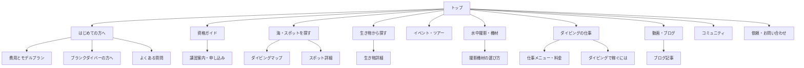
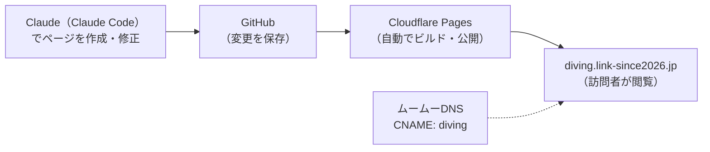
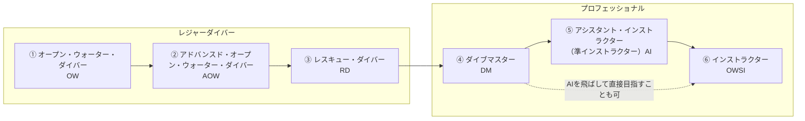

# ダイビング総合ポータルサイト 仕様書
### 〜 学ぶ・潜る・撮る・働く・つながる 〜

| 項目 | 内容 |
|---|---|
| ドキュメント名 | ダイビング総合ポータルサイト 仕様書（要件定義・サイト構成・機能仕様） |
| 版数 | v0.4 |
| 作成日 / 更新日 | 2026-11-22 / 2026-11-23 |
| 公開URL | `https://diving.link-since2026.jp` |
| 制作方式 | Next.js で制作し、Cloudflare Pages（無料）で公開。データは Cloudflare D1（データベース）と R2（画像）に置き、Pages Functions で読み書きする。運営者はバックオフィス（管理画面）で更新する |
| 関連資料 | `データモデル定義書.md`（データの構造）、`バックオフィス仕様書.md`（管理画面）、`SNS自動取り込み仕様書.md`（SNS投稿の自動取り込み） |
| 資料の保存場所 | `G:\マイドライブ\事業\DivingSite` |
| 前版 | 資格ステップアップ_アプリ仕様書.md（v0.1）。資格ガイドは本書の「F-01」と「付録A」に統合 |

---

## 1. 概要

### 1.1 サイトの目的
ダイビングに関する「知りたい」「やってみたい」「頼みたい」を1つのサイトでかなえる。
資格の取り方から、潜りに行く場所選び、撮影、仕事の依頼、仲間づくりまでをつなぎ、**「行ってみたい」から「申し込む・問い合わせる」まで迷わず進める**サイトにする。

### 1.2 サイトの3つの柱

| 柱 | 内容 | 主なゴール（訪問者にしてほしい行動） |
|---|---|---|
| ① 知る・学ぶ | 資格、仕事、費用、海や生き物の情報 | 講習の申し込み、記事の回遊 |
| ② 潜る・撮る | 目的別の海選び、ツアー、イベント、撮影機材 | ツアー・イベントへの参加、機材の購入（アフィリエイト） |
| ③ 頼む・つながる・稼ぐ | 仕事の依頼、コミュニティ、SNS・動画 | 仕事の依頼・問い合わせ、SNSフォロー、仲間との交流 |

### 1.3 想定ユーザー（ペルソナ）

| No. | ユーザー | 主なニーズ |
|---|---|---|
| P-1 | 未経験・初心者 | どんな資格があるか、費用、まず何をすればいいか |
| P-2 | ブランクダイバー | 久しぶりに潜りたい、不安なく再開したい |
| P-3 | ファンダイバー | 綺麗な海、狙いの魚・生き物、サンゴ礁・沈船・地形などの冒険 |
| P-4 | 水中写真・動画派 | 生き物を撮りたい、撮影機材を知りたい |
| P-5 | プロ志望 | どの資格で何の仕事ができるか、ダイビングで稼ぎたい |
| P-6 | 依頼者（法人・個人） | 水中撮影、ガイド、講習、調査などを頼みたい |

---

## 2. やりたいこと一覧と対応

いただいた20項目を、ページ・機能に割り当てる。

| No. | やりたいこと | 対応するページ | 対応する機能 | フェーズ |
|---|---|---|---|---|
| W-01 | どんな資格があるのか | 資格ガイド | F-01 資格ステップアップガイド | 1 |
| W-02 | その資格で何ができるのか | 資格ガイド | F-01（各資格の「できること」） | 1 |
| W-03 | 仕事としてどんなことを受けられるのか、何ができるのか | ダイビングの仕事 | F-02 仕事メニュー一覧 | 1 |
| W-04 | ダイビングの仕事を依頼するために連絡したい | 仕事の依頼・お問い合わせ | F-03 依頼・問い合わせフォーム | 1 |
| W-05 | ダイビングの資格を取りたい | 資格ガイド → 講習・申し込み | F-01 の「この講習を申し込む」ボタン、F-03 | 1 |
| W-06 | この魚を狙いたい | 生き物から探す | F-05 生き物図鑑 | 2 |
| W-07 | この獲物を見たい、撮りたい | 生き物から探す／水中撮影 | F-05、F-09 撮影機材紹介 | 2 |
| W-08 | 久しぶりに潜りたい | ブランクダイバーの方へ | リフレッシュ講習の案内、F-03 | 1 |
| W-09 | 綺麗な海を見たい | 海・スポットを探す | F-04 目的別スポット検索 | 1 |
| W-10 | スマホでも見れるようにしたい | 全ページ | 非機能要件（9章） | 1 |
| W-11 | InstagramやYouTubeの紹介動画を貼れるようにしたい | 動画・SNS、各ページ | F-08 動画・SNS埋め込み | 1 |
| W-12 | サンゴ礁や沈船、冒険をしたい | 海・スポットを探す | F-04（目的タグ：サンゴ・沈船・地形・洞窟・大物） | 1 |
| W-13 | マップ作りをしてみたい | ダイビングマップ | F-06 ダイビングマップ（参加型は第3フェーズ） | 2〜3 |
| W-14 | 稼ぎたい | ダイビングの仕事／サイト運営 | F-02（訪問者向け）、11章 収益化（運営者向け） | 1〜2 |
| W-15 | 撮影するための商品紹介 | 水中撮影・機材 | F-09 撮影機材紹介（アフィリエイト） | 2 |
| W-16 | どんな繋がりができるのか | コミュニティ | F-10 コミュニティ案内 | 2 |
| W-17 | どこに行けるのかが知りたい | 海・スポットを探す | F-04、F-06 | 1 |
| W-18 | ブログ・YouTube・アフィリエイト・Instagram・TikTok・Facebookのつなぎ | 全ページ（ヘッダー・フッター）、ブログ | F-08、F-11 ブログ | 1 |
| W-19 | イベントのスケジュール | イベント・ツアー | F-07 イベントカレンダー | 1 |
| W-20 | 計画、費用で参加するハードルを下げる | はじめての方へ／費用とプラン | F-12 費用の目安・モデルプラン、F-13 よくある質問 | 1 |

※「沈潜」は「沈船（レック）」として記載。

---

## 3. 参考サイトから取り入れる点

| 参考サイト | 良いところ | 本サイトでの取り入れ方 |
|---|---|---|
| ワールドダイビング（owd.jp）<br/>沖縄のダイビングショップ | ・ナビが「体験」「ライセンス」「ファンダイブ」「器材」「ブログ」「ショップ」「予約」と、目的ごとに分かれている<br/>・ライセンスはベーシックからインストラクターまでを一覧で並べている<br/>・リフレッシュダイビングを独立メニューにしている<br/>・記事の人気ランキング、カテゴリ一覧、パンくずで回遊させる<br/>・魚図鑑やポイントガイドなどの資産コンテンツ<br/>・Instagram、YouTube、TikTok などのSNS埋め込み | ・グローバルナビを目的別に構成<br/>・資格ガイドでプロまでの全ステップを見せる<br/>・「ブランクダイバーの方へ」を独立ページに<br/>・ブログに人気記事・カテゴリ・パンくずを設置<br/>・生き物図鑑とスポットガイドを資産コンテンツとして育てる<br/>・SNS・動画の埋め込みエリアを各所に |
| mic21（ダイビング用品の通販） | ・カテゴリをアクティビティ別に分け、その中を器材の種類別に細分化<br/>・「スタッフ推薦商品」「選び方ガイド」<br/>・ニュース（新商品・キャンペーン）枠<br/>・問い合わせ・よくある質問をヘッダーとフッターの両方に配置 | ・撮影機材紹介を「カメラ／ハウジング／ライト／アクセサリー」など種類別に<br/>・「運営者のおすすめ」「選び方ガイド」形式で紹介<br/>・トップに「お知らせ」枠<br/>・問い合わせ・FAQを常に見える場所に |
| ワールドエクスプローラ（wtp.co.jp）<br/>ダイビングツアー専門の旅行会社 | ・国内・海外、価格帯、エリア、目的（大物、サンゴ、地形など）で探せる<br/>・人気エリアランキングを「〇〇円〜」付きで表示<br/>・「初めての方向け」「ライセンス取得」「ポイントの見方」などの解説<br/>・お客様の声、キャンペーン<br/>・問い合わせ先と営業時間をトップ下部に明記 | ・スポット検索を「エリア × 目的 × 費用」で絞り込めるように<br/>・スポットやプランに費用の目安を表示<br/>・「はじめての方へ」ページ<br/>・参加者の声<br/>・トップ下部に連絡先・受付時間 |

---

## 4. サイトマップ



テキスト版:

```
トップ
├─ はじめての方へ
│   ├─ 費用とモデルプラン
│   ├─ ブランクダイバーの方へ（リフレッシュ）
│   └─ よくある質問
├─ 資格ガイド（資格ステップアップガイド）
│   └─ 講習案内・申し込み
├─ 海・スポットを探す（エリア × 目的 × 費用）
│   ├─ ダイビングマップ
│   └─ スポット詳細
├─ 生き物から探す（生き物図鑑）
│   └─ 生き物詳細
├─ イベント・ツアー（カレンダー）
├─ 水中撮影・機材
│   └─ 撮影機材の選び方
├─ ダイビングの仕事
│   ├─ 仕事メニュー・料金（依頼者向け）
│   └─ ダイビングで稼ぐには（プロ志望向け）
├─ 動画・ブログ
│   └─ ブログ記事
├─ コミュニティ
└─ 依頼・お問い合わせ
```

---

## 5. 共通レイアウト

### 5.1 グローバルナビ（ヘッダー）

| メニュー | 中のページ |
|---|---|
| はじめての方へ | 費用とモデルプラン／ブランクダイバーの方へ／よくある質問 |
| 資格 | 資格ガイド／講習案内・申し込み |
| 海を探す | スポット検索／ダイビングマップ／生き物図鑑 |
| イベント | イベント・ツアーのカレンダー |
| 撮影 | 水中撮影・機材 |
| 仕事 | 仕事メニュー・料金／ダイビングで稼ぐには |
| 動画・ブログ | 動画／ブログ |
| **お問い合わせ**（目立つボタン） | 依頼・お問い合わせフォーム |

### 5.2 フッター（全ページ共通）
- SNSアイコン：Instagram／YouTube／TikTok／Facebook／ブログ
- 主要ページへのリンク、サイトマップ
- 運営者情報、プライバシーポリシー、広告・アフィリエイトについての表記
- 問い合わせ先、受付時間

### 5.3 スマホ表示時の固定ボタン
スマホでは、画面下部に「お問い合わせ」「イベント」の2つを常に固定表示する。

---

## 6. ページ別仕様

### 6.1 トップページ

| 順番 | セクション | 内容 | 参考 |
|---|---|---|---|
| 1 | メインビジュアル | 綺麗な海の写真または動画と、キャッチコピー。「はじめての方」「資格を取りたい」「潜りに行きたい」「仕事を頼みたい」の4つの入口ボタン | wtp の注目スライド |
| 2 | 目的から探す | 「サンゴ礁」「沈船」「地形・洞窟」「大物」「マクロ（小さな生き物）」「綺麗な海」のアイコン | wtp の目的別 |
| 3 | 人気のスポット | 写真・エリア・費用の目安付きのカード（上位5件） | wtp の人気ランキング |
| 4 | 次のイベント | 直近3件のイベントとカレンダーへのリンク | － |
| 5 | 資格ステップアップ | 資格の流れを小さく表示し、資格ガイドへ誘導 | owd のライセンス一覧 |
| 6 | 動画・SNS | YouTube・Instagram の最新投稿 | owd の SNS 埋め込み |
| 7 | お知らせ・新着記事 | ブログやニュースの新着 | mic21 のニュース |
| 8 | 参加者の声 | 体験談のカード | wtp のお客様の声 |
| 9 | ダイビングの仕事 | 依頼できる仕事の一覧と「依頼する」ボタン | － |
| 10 | お問い合わせ | 連絡先、受付時間、フォームへのボタン | wtp の問い合わせ欄 |

### 6.2 はじめての方へ（W-01, W-20）
- ダイビングを始めるまでの流れ（体験 → 資格 → ファンダイブ）
- **費用とモデルプラン**（F-12）：資格取得や1泊2日のツアーなど、合計いくらかかるかを内訳付きで表示
- 必要な持ち物、レンタルでよいもの
- **よくある質問**（F-13）：泳げなくても大丈夫か、年齢制限、耳抜き、など

### 6.3 ブランクダイバーの方へ（W-08）
- ブランク期間ごとのおすすめ（例：1年未満／1〜3年／3年以上）
- リフレッシュ講習の内容と費用の目安
- 「再開の相談をする」ボタン（F-03 に「ブランク相談」を選んだ状態で移動）

### 6.4 資格ガイド（W-01, W-02, W-05）
- F-01 資格ステップアップガイド
- 各資格の下に「この講習を申し込む」ボタン → F-03
- 指導団体の違いの解説（付録A）

### 6.5 海・スポットを探す（W-09, W-12, W-17）
- F-04 目的別スポット検索
- F-06 ダイビングマップ
- スポット詳細ページ：写真、ベストシーズン、見られる生き物、レベル、費用の目安、行き方、関連動画、関連イベント

### 6.6 生き物から探す（W-06, W-07）
- F-05 生き物図鑑
- 生き物詳細：写真、見られる場所（スポットへのリンク）、季節、撮影のコツ、おすすめ機材（F-09 へ）

### 6.7 イベント・ツアー（W-19, W-20）
- F-07 イベントカレンダー
- 各イベント：日程、場所、対象レベル、費用、定員、申し込みボタン

### 6.8 水中撮影・機材（W-07, W-15）
- F-09 撮影機材紹介
- 撮影機材の選び方ガイド（予算別：スマホ＋ハウジング／アクションカメラ／ミラーレス）

### 6.9 ダイビングの仕事（W-03, W-04, W-14）
2つの読者に向けて構成を分ける。

**A. 依頼したい人向け（仕事メニュー・料金）**：F-02
**B. 仕事にしたい人向け（ダイビングで稼ぐには）**
- 資格と仕事の関係（例：ダイブマスターでガイドやアシスト、インストラクターで講習）
- ダイビング関連の仕事の種類：ガイド、インストラクター、水中撮影、ツアー企画、ショップスタッフ、SNS・動画発信、ライター など
- 業務としての潜水に関わる国家資格「潜水士」の紹介（必要となる場面は要確認）
- F-01 資格ガイドへのリンク

### 6.10 動画・ブログ（W-11, W-18）
- F-08 動画・SNS埋め込み、F-11 ブログ

### 6.11 コミュニティ（W-16）
- F-10 コミュニティ案内

### 6.12 依頼・お問い合わせ（W-04, W-05, W-08）
- F-03 依頼・問い合わせフォーム
- 電話・メール・受付時間、返信までの目安

---

## 7. 機能仕様

### 機能一覧

| ID | 機能名 | 概要 | 実装方法 | フェーズ |
|---|---|---|---|---|
| F-01 | 資格ステップアップガイド | 資格の順番・内容・取得条件・団体比較を図で表示 | サイト内コンポーネント（データはJSON） | 1 |
| F-02 | 仕事メニュー一覧 | 依頼できる仕事の内容と料金の目安 | サイト内ページ（データはJSON） | 1 |
| F-03 | 依頼・問い合わせフォーム | 用件を選んで送信。データベースに記録し、メールで通知。対応はバックオフィスで管理 | サイト独自フォーム＋`/api/inquiries` | 1 |
| F-04 | 目的別スポット検索 | エリア・目的・レベル・費用で絞り込み | サイト内コンポーネント（データはJSON） | 1（簡易版）〜2 |
| F-05 | 生き物図鑑 | 生き物を名前・種類・季節で探す | サイト内コンポーネント（データはJSON） | 2 |
| F-06 | ダイビングマップ | スポットを地図に表示 | Googleマイマップの埋め込み | 2 |
| F-07 | イベントカレンダー | イベント・ツアーの予定と空き人数を表示 | データベースのイベントを `/api/events` で取得して表示 | 1 |
| F-08 | 動画・SNS埋め込み | YouTube、Instagram、TikTok、Facebook の投稿を表示 | 各サービスの埋め込みコードをコンポーネント化 | 1 |
| F-09 | 撮影機材紹介 | 機材を種類別・予算別に紹介（アフィリエイトリンク） | サイト内ページ（データはJSON） | 2 |
| F-10 | コミュニティ案内 | 交流の場（LINEオープンチャット等）、イベント、仲間募集 | サイト内ページ | 2 |
| F-11 | ブログ | 記事の一覧・カテゴリ・人気記事 | サイト内（記事はMarkdownファイル） | 1 |
| F-12 | 費用の目安・モデルプラン | 内訳付きの費用表、簡易シミュレーター | サイト内コンポーネント（金額は `/api/prices` から最新値を取得） | 1 |
| F-13 | よくある質問 | 開閉式のQ&A | サイト内コンポーネント（データはJSON） | 1 |

### F-01 資格ステップアップガイド
詳細は **付録A**。

### F-02 仕事メニュー一覧

| 仕事メニュー（案） | 内容 | 料金表示 |
|---|---|---|
| 水中撮影・動画制作 | 個人の記念撮影、企業・メディアの撮影 | 〇〇円〜 |
| ダイビングガイド | 指定スポットの案内 | 〇〇円〜 |
| 講習・体験ダイビング | 資格講習、体験ダイビング | 〇〇円〜 |
| 水中調査・マップ作り | 海底や生き物の調査、ポイントマップの作成 | 要相談 |
| 取材・出演・SNS発信 | 記事や動画での紹介、PR | 要相談 |
| ツアー企画 | グループ向けのプランづくり | 要相談 |

- 各メニューに「この内容で依頼する」ボタン → F-03 に用件が選ばれた状態で移動
- 実績（写真・動画）を並べる

### F-03 依頼・問い合わせフォーム

| 項目 | 必須 | 形式 |
|---|---|---|
| 用件 | ○ | 選択：講習の申し込み／ブランク相談／イベント参加／仕事の依頼／その他 |
| 依頼の種類（用件が「仕事の依頼」のとき） | － | 選択：F-02 のメニュー |
| お名前 | ○ | テキスト |
| メールアドレス | ○ | メール |
| 電話番号 | － | テキスト |
| 希望日・時期 | － | 日付 |
| 人数 | － | 数値 |
| ダイビング経験（資格・本数） | － | 選択 |
| ご予算 | － | 選択 |
| 内容 | ○ | 長文 |
| 個人情報の取り扱いへの同意 | ○ | チェック |

- 送信内容は Googleスプレッドシートに自動で記録
- 新着時に運営者へメール通知。送信者には自動返信
- ページのURLに用件を含め、F-02 などから来たときに選択済みにする

### F-04 目的別スポット検索
- 絞り込み条件：エリア（国内・海外／地域）、目的（サンゴ礁、沈船、地形・洞窟、大物、マクロ、透明度）、レベル（体験／OW／AOW以上）、費用の目安、ベストシーズン
- 結果はカード表示：写真、スポット名、目的タグ、レベル、費用の目安「〇〇円〜」
- データはJSONファイルで管理し、1件追加すれば表示が増える形にする（追加はClaudeに依頼）
- 第1フェーズは、目的別の一覧ページによる簡易版でもよい

### F-05 生き物図鑑
- 項目：名前、写真、種類（魚・ウミガメ・甲殻類など）、大きさ、見られる季節、見られるスポット、撮影のコツ
- 検索：名前、種類、季節
- 「この生き物に会えるスポット」→ F-04、「撮影におすすめの機材」→ F-09

### F-06 ダイビングマップ
- 第2フェーズ：Googleマイマップでスポットを地図に表示し、ページに埋め込む。目的別にレイヤー（色）を分ける
- 第3フェーズ：参加型マップ。ユーザーが「見た生き物・場所・日付・写真」をフォームで投稿し、運営者が確認してマップに反映する

### F-07 イベントカレンダー
- イベント専用のGoogleカレンダーを作り、イベントページに埋め込む
- 予定の説明欄に、費用、対象レベル、定員、申し込みリンクを記載
- トップページには直近3件を表示する

### F-08 動画・SNS埋め込み

| サービス | 方法 |
|---|---|
| YouTube | 動画IDまたは再生リストIDを指定して埋め込む |
| Instagram | 投稿URLを指定して埋め込む |
| TikTok | 投稿URLを指定して埋め込む |
| Facebook | 投稿URLまたはページプラグインで埋め込む |

- 投稿のURLをデータに追加するだけで表示できる共通コンポーネントにする
- Instagram・YouTube・Facebook・TikTok の自分の投稿は、定期的に自動で取り込んで表示する（詳細は `SNS自動取り込み仕様書.md`）

- スポット詳細、生き物詳細、イベントなど、関係するページに関連動画を置く
- 投稿のたびにサイトを更新しなくても最新が見えるよう、YouTubeは再生リスト単位で埋め込む

### F-09 撮影機材紹介
- 分類：カメラ／ハウジング／水中ライト／アクセサリー（ストロボ、ロッドなど）／スマホ用
- 予算別のおすすめセット（例：3万円以内、10万円以内、それ以上）
- 「運営者のおすすめ」コメント付きのカード
- 購入リンクはアフィリエイトリンク。ページ上部に広告を含む旨を表記する

### F-10 コミュニティ案内
- できるつながり：ダイビング仲間、バディ探し、撮影仲間、プロとのつながり、イベントでの交流
- 参加方法：SNSのフォロー、LINEオープンチャット等への参加、イベント参加
- 参加者の声・活動の写真

### F-11 ブログ
- カテゴリ：初心者向け、スポット紹介、生き物、撮影テクニック、機材レビュー、仕事・キャリア、イベントレポート
- 人気記事、カテゴリ一覧、パンくずリストで回遊させる
- 記事の最後に関連ページ（スポット、イベント、問い合わせ）へのボタン

### F-12 費用の目安・モデルプラン
- モデルプラン例：資格取得（OW）、体験ダイビング、1泊2日の国内ツアー、ブランクからの再開
- 内訳：講習・ツアー代、器材レンタル、交通費、宿泊、その他
- 簡易シミュレーター：「エリア」「日数」「器材レンタルの有無」を選ぶと合計の目安を表示
- 「この内容で相談する」ボタン → F-03

### F-13 よくある質問
- カテゴリ：はじめて、資格、費用、持ち物、安全・健康、イベント、依頼
- 開閉式で表示。検索エンジン向けに FAQ の構造化データも出力する

---

## 8. 技術構成と公開方法

### 8.1 技術構成

| 項目 | 採用するもの | 補足 |
|---|---|---|
| フレームワーク | Next.js（App Router、静的書き出し） | すべてのページを事前にHTMLとして書き出す。サーバー不要 |
| 言語・スタイル | TypeScript、Tailwind CSS | |
| コンテンツ管理 | ブログ：Markdownファイル／スポット・生き物・資格・FAQ・仕事メニュー：JSONファイル | 追加・修正はClaudeに依頼して反映 |
| ソース管理 | GitHub（非公開リポジトリ） | 変更履歴が残り、いつでも元に戻せる |
| 公開（ホスティング） | Cloudflare Pages（無料プラン） | GitHubに変更を送ると自動でビルド・公開。SSL（https）も自動 |
| 公開URL | `https://diving.link-since2026.jp` | ムームードメインのドメインのサブドメイン |
| DNS | ムームーDNS（現状のまま） | CNAMEレコードを1行追加するだけ |
| データベース | Cloudflare D1 | 料金・イベント・スポット・問い合わせなど。構造は `データモデル定義書.md` |
| 画像置き場 | Cloudflare R2 | |
| サーバー側の処理 | Cloudflare Pages Functions | 公開API（料金・イベントなど）と管理API。自前のサーバーは持たない |
| 管理画面 | バックオフィス（`/admin`） | Google Workspace のアカウントでログイン。詳細は `バックオフィス仕様書.md` |
| 金額の一括登録 | Excel（バックオフィスから取り込み・書き出し） | 正となるデータはデータベース |
| アクセス解析 | Cloudflare Web Analytics または Google Analytics | 12章 フェーズ1で決定 |
| 開発 | Claude（Claude Code） | コードの作成・修正・公開作業 |

### 8.2 公開の流れ



### 8.3 ドメイン・DNSの設定方針

| レコード | 対応 |
|---|---|
| CNAME `diving` → `（Cloudflare Pagesのプロジェクト名）.pages.dev` | **追加する**（設定値は Cloudflare Pages でカスタムドメインを登録したときに表示される値に従う） |
| MX（Google Workspaceのメール） | **変更しない** |
| TXT（Googleのドメイン確認、SPF、DKIM など） | **変更しない** |
| ネームサーバー | **変更しない**（ムームーDNSのまま） |

- 作業前に、ムームーDNSの現在の設定画面をスクリーンショットで保存しておく
- 設定後、メールの送受信が問題なくできることを確認する
- 既存のGoogleサイト（`sites.google.com/link-since2026.jp/top`）はそのまま残る

### 8.4 費用

| 項目 | 費用 |
|---|---|
| ドメイン（ムームードメイン） | 現在の契約のまま（次回の更新期限は 2027/02/18） |
| Cloudflare Pages、GitHub | 無料 |
| Google Workspace | 現在の契約のまま |

### 8.5 この構成でできること・注意点

| 内容 | 対応 |
|---|---|
| デザイン・ページ構成 | 自由に作れる |
| スマホ対応、画面下の固定ボタン | 対応できる |
| 検索エンジン対策 | ページタイトル、説明文、サイトマップ（sitemap.xml）、SNSで共有したときの表示（OGP）を設定できる |
| YouTube、Instagram、TikTok、Facebook、Googleカレンダー・マップ・フォーム | 埋め込める |
| 問い合わせフォーム | Pages Functions で受け付け、データベースに保存してメールで通知する |
| データの反映 | 料金・イベント・お知らせは保存するとすぐ反映（即時）。スポット・ブログなどは管理画面の「サイトに反映」で組み立て直して反映（検索エンジン対策のため） |
| 会員登録・ログイン、ユーザー投稿の自動掲載 | 現時点では対象外。必要になったら同じ仕組み（Functions＋D1）で追加を検討 |
| 更新作業 | 料金・イベント・コンテンツはバックオフィスで運営者が更新する。デザインや機能の変更は Claude に依頼する |

---

## 9. 非機能要件

| 区分 | 要件 |
|---|---|
| スマホ対応（W-10） | スマホ表示を基本に設計する（幅767px以下で縦並び）。すべてのページをスマホで確認してから公開する |
| 表示速度 | 写真は横幅1,600px程度に縮小してから載せる |
| 文字・配色 | 海をイメージした青系で統一。文字と背景のコントラストを確保 |
| 操作性 | 問い合わせボタンは、どのページからも1〜2タップで届く位置に置く |
| アクセシビリティ | 画像に説明文（代替テキスト）を付ける。色だけで情報を区別しない |
| 独自ドメイン | `https://diving.link-since2026.jp` で公開（https必須） |
| 表示速度 | 画像は自動で最適化した形式（WebPなど）で配信する |
| 検索エンジン対策 | 全ページにタイトル・説明文・OGPを設定。sitemap.xml を出力 |

---

## 10. 運用

| 項目 | 頻度 | 担当 |
|---|---|---|
| イベントの登録 | 決まり次第 | 運営者 |
| ブログ・SNS投稿 | 週1回以上を目標 | 運営者 |
| スポット・生き物データの追加 | 月1回 | 運営者 |
| 資格の取得条件・料金の見直し | 半年に1回 | 運営者 |
| 問い合わせへの返信 | 原則2営業日以内 | 運営者 |

---

## 11. 収益化（W-14 運営者が稼ぐ仕組み）

| 収益源 | 内容 | 関連機能 |
|---|---|---|
| 仕事の受注 | 撮影、ガイド、講習、調査などの依頼 | F-02、F-03 |
| 講習・イベント参加費 | 資格講習、ツアー、イベント | F-01、F-07 |
| アフィリエイト | 撮影機材・器材・旅行の紹介 | F-09、F-11 |
| 動画・SNS | YouTubeの広告収益、企業とのタイアップ | F-08 |

- アフィリエイトやタイアップを含むページには、広告であることを分かるように表記する（景品表示法のステルスマーケティング規制への対応）

---

## 12. 段階的なリリース計画

| フェーズ | 目安 | 公開するもの |
|---|---|---|
| 0 | 準備 | GitHub・Cloudflareのアカウント作成、開発環境の準備、`diving.link-since2026.jp` の接続（仮のトップページで動作確認） |
| 1 | まず公開 | トップ、はじめての方へ（費用・FAQ）、ブランクダイバーの方へ、資格ガイド（F-01）、仕事メニュー（F-02）、問い合わせフォーム（F-03）、イベントカレンダー（F-07）、動画・SNS（F-08）、ブログ（F-11）、スポットの簡易版（F-04） |
| 2 | 1〜3か月後 | スポット検索の本格版、生き物図鑑（F-05）、ダイビングマップ（F-06）、撮影機材紹介（F-09）、コミュニティ（F-10）、サイト独自の問い合わせフォーム |
| 3 | 様子を見て | 参加型マップ、会員機能など。必要になったら Cloudflare のサーバー機能（Pages Functions など）で追加を検討 |

---

## 13. 未決事項

| No. | 内容 |
|---|---|
| Q-01 | サイト名（ブランド名）とキャッチコピー |
| Q-02 | 対象エリア（特定の海に絞るか、国内全域・海外まで扱うか） |
| Q-03 | ブログはサイト内（Markdown）で作る。note など外部ブログとの併用・転載をするか |
| Q-04 | 所属している指導団体（資格ガイドの初期表示、講習案内に影響） |
| Q-05 | 仕事メニューの種類と料金 |
| Q-06 | コミュニティの場（LINEオープンチャット、Discord、Facebookグループ など） |
| Q-07 | 使用するSNSアカウントとURL |
| Q-08 | アフィリエイトで使うサービス（Amazon、楽天 など） |
| Q-09 | 掲載する写真・動画の素材（自前の素材がどのくらいあるか） |
| Q-10 | 資格ガイドに料金・講習日数、ジュニア資格、スペシャルティを載せるか |
| Q-11 | 開発用のフォルダの場所（案：`C:\dev\diving-site`）と、Claude Code を使うか |
| Q-12 | 既存のGoogleサイト（`sites.google.com/link-since2026.jp/top`）から新サイトへリンクを張るか |

---

## 付録A F-01 資格ステップアップガイド 詳細仕様

### A.1 目的
ダイビングの資格（Cカード）が「どの順番で取得できるのか」「どんな種類があるのか」「何ができるようになるのか」「どの団体が発行しているのか」を1画面で理解できるようにする。

### A.2 実装方針
- 資格ガイドページ（`/license`）のコンポーネントとして実装する
- 資格・団体のデータは `data/licenses.json` に分け、文言の修正はデータだけで済むようにする
- 図はHTML/CSS（またはインラインSVG）で描き、外部ライブラリに頼らない
- 文章はすべてページの本文として出力されるため、検索エンジンにも読まれる

### A.3 機能

| ID | 機能 | 概要 |
|---|---|---|
| F-01-1 | ステップアップ図 | 資格を取得順に矢印でつないだ図 |
| F-01-2 | 資格詳細 | 各資格をタップすると「どんな資格か」「できること」「取得条件」「次のステップ」を表示 |
| F-01-3 | 区分の色分け | レジャー（水色 `#4FC3F7`）とプロ（深い青 `#0D47A1`）。AIは点線枠＋「任意」バッジ |
| F-01-4 | 指導団体の切り替え | PADI / SSI / NAUI のタブ |
| F-01-5 | 指導団体の比較表 | 団体の特徴と資格名の対応表 |
| F-01-6 | 申し込みボタン | 各資格の詳細に「この講習を申し込む」→ F-03 |
| F-01-7 | 注意書き・出典 | 条件が変わる可能性の注記、出典、最終確認日 |

### A.4 ステップアップ図（PADIの例）



```
【レジャー】                                         【プロ】
① OW ──▶ ② AOW ──▶ ③ レスキュー ──▶ ④ ダイブマスター ──▶ ⑤ 準インストラクター(AI) ──▶ ⑥ インストラクター
 はじめての資格   経験を広げる    人を助ける力    ガイド・アシスト     一部の講習を担当        すべての基本講習を担当
                                                      └──────────── AIを経由せず直接目指すことも可 ───────────┘
```

- PC：横並び、スマホ：縦並び
- ③と④の間に「ここからプロ」の区切り
- 初期表示は ① OW の詳細

### A.5 資格詳細データ（PADIの例）

※ 2026年11月時点で PADI の公開情報から確認。実装前に再確認する。

| No. | 資格 | 区分 | どんな資格か・できること | 主な取得条件 |
|---|---|---|---|---|
| ① | オープン・ウォーター・ダイバー（OW） | レジャー | 最初に取る基本の資格。トレーニングと同程度の環境で、資格を持つバディと一緒に潜れる | 最低年齢 15歳（10〜14歳はジュニア） |
| ② | アドバンスド・オープン・ウォーター・ダイバー（AOW） | レジャー | ナビゲーションやディープなどを体験し、潜れる環境を広げる | OW取得済み。15歳以上（12〜14歳はジュニア）。最大深度の目安：12〜14歳 21m、15歳以上 30m |
| ③ | レスキュー・ダイバー（RD） | レジャー | トラブルの予防と対処、仲間の救助を学ぶ。プロを目指す人の前提資格 | AOW（またはアドベンチャー・ダイバー＋ナビゲーション）取得済み。24か月以内のEFR（応急手当）講習修了。12歳以上 |
| ④ | ダイブマスター（DM） | プロ | プロの最初のステップ。ダイビングのガイドや講習のアシスト | 18歳以上（15〜17歳はジュニア・ダイブマスター）。レスキュー・ダイバー取得済み。24か月以内のEFR講習修了。開始時40本以上、認定時60本以上のログ。12か月以内の医師の診断 |
| ⑤ | アシスタント・インストラクター（AI／準インストラクター） | プロ | DMとインストラクターの間の任意のステップ。一部のコースを単独で指導できる | DM（または同等の資格）取得済み。インストラクター開発コース（IDC）のAIパートを修了 |
| ⑥ | オープン・ウォーター・スクーバ・インストラクター（OWSI） | プロ | 基本コースを一通り指導できる | IDCを修了し、インストラクター試験（IE）に合格。IDC参加には18歳以上、ダイバー認定から6か月以上などの条件あり |

### A.6 団体ごとの違い（タブ切り替え時の注記）
- **SSI**：レスキューに当たる資格は「ダイバー・ストレス＆レスキュー」。プロの入口として「ダイブガイド」があり、そこからダイブマスターへ進む
- **NAUI**：プロコースの前に「マスター・スクーバ・ダイバー」が必要。ダイブマスターがアシスタント・インストラクターより上位に位置付けられ、どちらからでもインストラクター養成コース（ITC）に進める

### A.7 主な指導団体の特徴

ダイビングの資格（Cカード）は国家資格ではなく、民間の指導団体が独自の基準で講習を行い発行している。国内のダイビングショップの多くは、Cカード協議会を構成する指導団体のいずれかに加盟している。

| 団体 | 正式名称 | 発祥 | 特徴 |
|---|---|---|---|
| PADI（パディ） | Professional Association of Diving Instructors | 1966年・アメリカ | 世界最大の指導団体。海外のショップでも通じやすい。段階的にステップアップする教育システム |
| NAUI（ナウイ） | National Association of Underwater Instructors | 1960年・アメリカ | 非営利の指導者団体。プロへ進む前にマスター・スクーバ・ダイバーが必要 |
| SSI（エスエスアイ） | Scuba Schools International | 1970年代・アメリカ | ダイビングショップ（トレーニングセンター）を軸にした団体。オンライン学習と実習を組み合わせる |
| CMAS（クマス） | 世界水中連盟 | ヨーロッパ | 各国の連盟が加盟する国際組織。1〜4つ星の「スター制」 |
| BSAC（ビーサック） | British Sub-Aqua Club | 1953年・イギリス | イギリス最大のダイビングクラブ。日本では BSAC JAPAN が1987年から活動 |
| 国内団体（JP など） | 各団体 | 日本 | 日本発祥の指導団体。国内ショップでの講習が中心 |

### A.8 資格名の対応表（目安）

| レベル | PADI | SSI | NAUI | CMAS |
|---|---|---|---|---|
| はじめての資格 | オープン・ウォーター・ダイバー | オープン・ウォーター・ダイバー | オープン・ウォーター・スクーバ・ダイバー | 1スター・ダイバー |
| 経験を広げる | アドバンスド・オープン・ウォーター・ダイバー | アドバンスド・オープン・ウォーター・ダイバー | アドバンスド・スクーバ・ダイバー | 2スター・ダイバー |
| 救助を学ぶ | レスキュー・ダイバー | ダイバー・ストレス＆レスキュー | レスキュー・スクーバ・ダイバー | （2〜3スターに含まれる） |
| プロの準備 | － | － | マスター・スクーバ・ダイバー | － |
| ガイド・アシスト | ダイブマスター | ダイブガイド → ダイブマスター | ダイブマスター ※ | 3スター・ダイバー |
| 準インストラクター | アシスタント・インストラクター | アシスタント・インストラクター | アシスタント・インストラクター ※ | 1スター・インストラクター |
| インストラクター | オープン・ウォーター・スクーバ・インストラクター | オープン・ウォーター・インストラクター | インストラクター | 2スター・インストラクター |

※ NAUI では、ダイブマスターがアシスタント・インストラクターより上位。団体間の対応は目安で、正式な互換性は各団体・ショップに確認する。

### A.9 国内の加盟ショップ数（参考）

国土交通省の資料（令和6年12月現在、各団体HPのショップリストをもとに集計。複数団体に加盟するショップあり）。

| 団体 | ショップ数 | 団体 | ショップ数 |
|---|---|---|---|
| PADI | 446 | SSI | 80 |
| NAUI | 137 | JCS | 71 |
| Stars | 115 | SDI | 53 |
| JEFF | 94 | JUDF | 49 |
| JP | 93 | SNSI | 46 |
| BSAC | 90 | Three I | 12 |
| | | KD | 11 |

### A.10 データ構造

資格・団体のデータはHTML内のJavaScriptオブジェクトとして持ち、表示はデータから生成する。文言の修正はデータ部分だけを書き換えればよい形にする。

```json
{
  "agencies": [
    {
      "id": "padi",
      "name": "PADI",
      "steps": [
        {
          "order": 1,
          "id": "ow",
          "nameJa": "オープン・ウォーター・ダイバー",
          "nameEn": "Open Water Diver",
          "abbr": "OW",
          "category": "leisure",
          "optional": false,
          "summary": "最初に取る基本の資格",
          "canDo": ["資格を持つバディと一緒に潜れる"],
          "requirements": ["最低年齢 15歳（10〜14歳はジュニア）"],
          "applyUrl": "（F-03 のURL＋用件パラメータ）",
          "next": "aow"
        }
      ],
      "notes": []
    }
  ],
  "equivalence": [
    { "level": "はじめての資格", "padi": "オープン・ウォーター・ダイバー", "ssi": "オープン・ウォーター・ダイバー", "naui": "オープン・ウォーター・スクーバ・ダイバー", "cmas": "1スター・ダイバー" }
  ],
  "meta": { "lastChecked": "2026-11-22" }
}
```

---

## 付録B フォルダ構成

### B.1 資料（Googleドライブ）

```
G:\マイドライブ\事業\DivingSite\
├─ ダイビング総合ポータルサイト_仕様書.md   ← 本書
├─ 資格ステップアップ_アプリ仕様書.md       ← 前版（v0.1）
└─ 資格ステップアップ.html                  ← Googleサイト用の試作（新構成では使わない）
```

### B.2 サイトのコード（PC内の開発フォルダ＋GitHub）

コード一式はGoogleドライブの同期フォルダには置かない（同期の負荷やファイルの競合を避けるため）。

```
C:\dev\diving-site\            ← 案（13章 Q-11）
├─ app\                        ← 各ページ（トップ、資格、スポット、イベント…）
├─ components\                 ← 共通部品（ヘッダー、フッター、カード、SNS埋め込み…）
├─ content\blog\               ← ブログ記事（Markdown）
├─ data\                       ← licenses.json、spots.json、creatures.json、faq.json、works.json
├─ public\images\              ← 写真
└─ docs\                       ← 仕様書のコピー
```

---

## 出典（2026-11-22 確認）

**参考サイト（構成の参考）**
- ワールドダイビング「ダイビング・スキルアップ」 https://www.owd.jp/skill/advanced/
- mic21 オンラインショップ https://ec.mic21.com/shop/default.aspx
- ワールドエクスプローラ（株式会社ワールドツアープランナーズ） https://www.wtp.co.jp/

**資格・指導団体**
- PADI「What’s the Difference Between Assistant Instructor and Open Water Scuba Instructor」（日本語版） https://blog.padi.com/jp/whats-the-difference-between-assistant-instructor-and-open-water-scuba-instructor/
- PADI「PADI Divemaster Requirements」 https://blog.padi.com/padi-divemaster-requirements/
- PADI「PADI Diving Restrictions」 https://blog.padi.com/padi-diving-restrictions/
- PADI「Rescue Diver コース概要」 https://padi.com/node/1241
- PADI「Assistant Instructor」 https://padi.com/courses/assistant-instructor
- PADI「PADI Professional Levels」 https://blog.padi.com/padi-professional-levels/
- PADI「How to Become a Scuba Instructor」 https://www.padi.com/mx/en/blog/how-to-become-a-scuba-instructor
- PADI「PADIについて」 https://www.padi.com/ja/about
- SSI「From Enthusiast to Dive Professional」 https://www.divessi.com/en/blog/From-dive-enthusiast-to-dive-professional-1359
- SSI「Dive Guide」 https://divessi.com/professional/scuba-diving/dive-guide
- SSI「Assistant Instructor」 https://www.divessi.com/professional/scuba-diving/assistant-instructor
- NAUI「Training Progression」 https://naui.org/certifications/training-progression
- NAUI「Leadership Courses」 https://naui.org/certifications/leadership
- NAUI「Assistant Instructor」 https://www.naui.org/learn/leadership/assistant-instructor
- NAUI「Rescue Scuba Diver」 https://naui.org/certifications/entry-level/rescue-scuba-diver
- Wikipedia「Divemaster」 https://en.wikipedia.org/wiki/Divemaster
- Wikipedia「National Association of Underwater Instructors」 https://en.wikipedia.org/wiki/National_Association_of_Underwater_Instructors
- Scuba.com「Scuba Certification Agencies」 https://www.scuba.com/blog/scuba-guides/scuba-certification-agencies-padi-naui-bsac-cmas-and-more/
- アクティビティジャパン「ダイビングライセンスの種類の違い」 https://activityjapan.com/news/%ef%bc%88%e6%9b%b4%e6%96%b0%e7%94%a8%ef%bc%89%e3%83%80%e3%82%a4%e3%83%93%e3%83%b3%e3%82%b0%e3%83%a9%e3%82%a4%e3%82%bb%e3%83%b3%e3%82%b9%e7%a8%ae%e9%a1%9e%e3%81%ae%e9%81%95%e3%81%84/
- BSAC JAPAN https://www.bsac.co.jp/en/
- 国土交通省「ダイビング船事故防止に向けたアンケート調査の結果について」 https://www.mlit.go.jp/maritime/content/001886644.pdf

---

## 改訂履歴

| 版数 | 日付 | 内容 |
|---|---|---|
| v0.1 | 2026-11-22 | 「資格ステップアップガイド アプリ仕様書」として初版作成 |
| v0.2 | 2026-11-22 | タイトルを「ダイビング総合ポータルサイト 仕様書」に変更。サイトでやりたいこと20項目、参考サイト3つの分析、サイトマップ、ページ別仕様、機能仕様（F-01〜F-13）、実装方針、収益化、リリース計画を追加。資格ガイドは付録Aに統合 |
| v0.3 | 2026-11-23 | Googleサイトをやめ、Next.js＋Cloudflare Pages で制作する構成に変更。公開URLを `diving.link-since2026.jp` に決定。8章を「技術構成と公開方法」（DNS設定方針・費用を含む）に差し替え。機能の実装方法、非機能要件、リリース計画、未決事項、付録A・Bを更新 |
| v0.4 | 2026-11-23 | データを Cloudflare D1／R2 に持ち、バックオフィスで更新する構成に変更。F-03・F-07・F-12 の実装方法と8章の技術構成を更新。`データモデル定義書.md` と `バックオフィス仕様書.md` を追加 |
