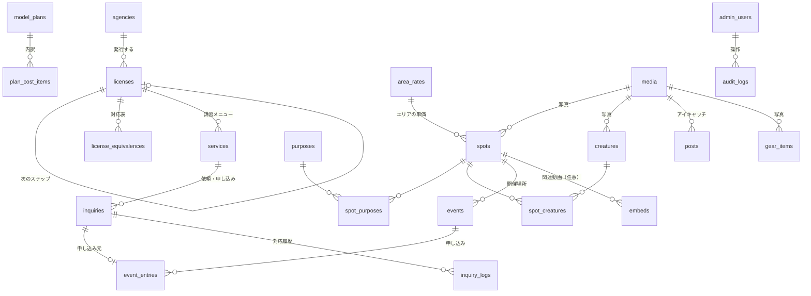

# ダイビング総合ポータルサイト データモデル定義書

| 項目 | 内容 |
|---|---|
| ドキュメント名 | データモデル定義書 |
| 版数 | v0.1（初版ドラフト） |
| 作成日 | 2026-11-23 |
| 対象 | `https://diving.link-since2026.jp` の公開サイトとバックオフィス |
| 関連資料 | `ダイビング総合ポータルサイト_仕様書.md`（機能 F-01〜F-13）、`バックオフィス仕様書.md` |

---

## 1. 前提

### 1.1 データの置き場所
データは、サイトと同じ Cloudflare の中に置く。自前のサーバーは持たない。

| 置き場所 | サービス | 入れるもの |
|---|---|---|
| データベース | Cloudflare D1（SQLite 互換） | 料金、スポット、イベント、問い合わせなど、表の形のデータ |
| 画像置き場 | Cloudflare R2 | 写真・画像ファイル。データベースには保存場所（キー）だけを持つ |
| 取り出し口（API） | Cloudflare Pages Functions | サイトや管理画面がデータを読み書きするための窓口 |

### 1.2 反映方式
データの性質によって、サイトへの出し方を2つに分ける。

| 反映方式 | 意味 | 対象 |
|---|---|---|
| **即時** | ページを開いたときに API から最新の値を取得する。保存した瞬間にサイトに出る | 料金、モデルプラン、エリア単価、イベント・空き状況、お知らせ |
| **公開操作で反映** | 管理画面の「サイトに反映」で、サイトを組み立て直す（数分）。ページに文章として書き出されるため、検索エンジンに読まれる | 資格、スポット、生き物、ブログ、FAQ、機材、参加者の声 |

### 1.3 共通ルール
- テーブル名・列名は英小文字とアンダースコア（例：`model_plans`）。日本語名は「論理名」として本書に記載する
- すべてのテーブルに、次の共通列を持つ

| 列 | 型 | 説明 |
|---|---|---|
| `id` | INTEGER | 主キー（自動採番） |
| `created_at` | TEXT | 作成日時（ISO 8601、UTC） |
| `updated_at` | TEXT | 更新日時（ISO 8601、UTC） |
| `updated_by` | TEXT | 最後に更新した管理者のメールアドレス |

- 公開・非公開を切り替えるデータは `status`（`draft` 下書き／`published` 公開／`archived` 非表示）を持つ。削除は原則せず `archived` にする（論理削除）
- 並び順を持つデータは `sort_order`（INTEGER、小さいほど先）を持つ
- URLに使う識別子は `slug`（英小文字・数字・ハイフン、一意）を持つ

### 1.4 金額のルール
- 金額はすべて **円・整数・税込** で持つ（列名の末尾は `_yen`）
- 金額を持つデータには、次の2列を必ず持つ

| 列 | 型 | 説明 |
|---|---|---|
| `is_estimate` | INTEGER（0/1） | 1＝相場の目安、0＝自社が実際に提供する価格 |
| `checked_on` | TEXT（日付） | 金額を確認した日。サイトに「〇年〇月時点の目安」と表示する |

- 自社の提供価格（講習・ガイド・撮影など）と、相場の目安（スポットの旅行費用など）は、`is_estimate` で区別して表示を分ける

---

## 2. 全体の関係（ER図）

---

## 3. テーブル一覧

| 区分 | テーブル | 論理名 | 反映方式 | 主な利用機能 |
|---|---|---|---|---|
| 資格 | `agencies` | 指導団体 | 公開操作 | F-01 |
| 資格 | `licenses` | 資格 | 公開操作 | F-01 |
| 資格 | `license_equivalences` | 資格名の対応表 | 公開操作 | F-01 |
| 料金 | `services` | 自社メニュー（講習・ガイド・撮影など） | 即時 | F-01、F-02 |
| 料金 | `model_plans` | モデルプラン | 即時 | F-12 |
| 料金 | `plan_cost_items` | モデルプランの内訳 | 即時 | F-12 |
| 料金 | `area_rates` | エリア単価 | 即時 | F-12 |
| 海・生き物 | `spots` | ダイビングスポット | 公開操作（費用の目安のみ即時） | F-04、F-06 |
| 海・生き物 | `purposes` | 目的（サンゴ礁・沈船など） | 公開操作 | F-04 |
| 海・生き物 | `spot_purposes` | スポットと目的の対応 | 公開操作 | F-04 |
| 海・生き物 | `creatures` | 生き物 | 公開操作 | F-05 |
| 海・生き物 | `spot_creatures` | スポットと生き物の対応 | 公開操作 | F-05 |
| イベント | `events` | イベント・ツアー | 即時 | F-07 |
| イベント | `event_entries` | イベントの申し込み | 管理画面のみ | F-07 |
| 問い合わせ | `inquiries` | 問い合わせ・依頼 | 管理画面のみ | F-03 |
| 問い合わせ | `inquiry_logs` | 対応履歴 | 管理画面のみ | F-03 |
| コンテンツ | `posts` | ブログ記事 | 公開操作 | F-11 |
| コンテンツ | `faqs` | よくある質問 | 公開操作 | F-13 |
| コンテンツ | `gear_items` | 撮影機材 | 公開操作 | F-09 |
| コンテンツ | `testimonials` | 参加者の声 | 公開操作 | トップ |
| コンテンツ | `notices` | お知らせ | 即時 | トップ |
| コンテンツ | `community_links` | コミュニティの参加先 | 公開操作 | F-10 |
| コンテンツ | `embeds` | 動画・SNS投稿 | 公開操作 | F-08 |
| コンテンツ | `media` | 画像 | — | 全般 |
| 運用 | `settings` | サイト設定 | 即時 | 全般 |
| 運用 | `admin_users` | 管理者 | — | バックオフィス |
| 運用 | `audit_logs` | 操作履歴 | — | バックオフィス |
| 運用 | `import_jobs` | Excel取り込み履歴 | — | バックオフィス |

---

## 4. テーブル定義

共通列（`id`、`created_at`、`updated_at`、`updated_by`）は省略する。
「必須」欄：○＝必須、空欄＝任意。

### 4.1 資格

#### `agencies`（指導団体）
| 列 | 論理名 | 型 | 必須 | 説明・制約 |
|---|---|---|---|---|
| `code` | 団体コード | TEXT | ○ | 一意。`padi`、`ssi`、`naui`、`cmas`、`bsac`、`jp` など |
| `name` | 表示名 | TEXT | ○ | PADI |
| `full_name` | 正式名称 | TEXT | | Professional Association of Diving Instructors |
| `origin` | 発祥 | TEXT | | 1966年・アメリカ |
| `feature` | 特徴 | TEXT | | 1〜2文 |
| `official_url` | 公式サイト | TEXT | | |
| `jp_shop_count` | 国内加盟ショップ数 | INTEGER | | 参考値 |
| `jp_shop_count_source` | ショップ数の出典 | TEXT | | 国土交通省資料（令和6年12月）など |
| `show_tab` | 資格ガイドのタブに出す | INTEGER（0/1） | ○ | |
| `sort_order` | 並び順 | INTEGER | ○ | |
| `status` | 公開状態 | TEXT | ○ | draft／published／archived |

#### `licenses`（資格）
| 列 | 論理名 | 型 | 必須 | 説明・制約 |
|---|---|---|---|---|
| `agency_id` | 指導団体 | INTEGER | ○ | → `agencies.id` |
| `code` | 資格コード | TEXT | ○ | 団体内で一意。`ow`、`aow`、`rescue`、`dm`、`ai`、`instructor` |
| `step_order` | 取得順 | INTEGER | ○ | 1〜 |
| `category` | 区分 | TEXT | ○ | `leisure`（レジャー）／`pro`（プロ） |
| `is_optional` | 任意のステップ | INTEGER（0/1） | ○ | AI などは 1 |
| `name_ja` | 日本語名 | TEXT | ○ | オープン・ウォーター・ダイバー |
| `name_en` | 英語名 | TEXT | | Open Water Diver |
| `abbr` | 略称 | TEXT | | OW |
| `summary` | どんな資格か | TEXT | ○ | 1〜2文 |
| `can_do` | できること | TEXT（JSON配列） | | `["資格を持つバディと潜れる", …]` |
| `requirements` | 主な取得条件 | TEXT（JSON配列） | | `["最低年齢 15歳", …]` |
| `min_age` | 最低年齢 | INTEGER | | |
| `min_dives` | 必要な経験本数 | INTEGER | | |
| `next_license_id` | 次のステップ | INTEGER | | → `licenses.id` |
| `note` | 団体ごとの注記 | TEXT | | NAUI の順番の違いなど |
| `source_url` | 出典 | TEXT | | |
| `checked_on` | 確認日 | TEXT（日付） | ○ | |
| `status` | 公開状態 | TEXT | ○ | |

#### `license_equivalences`（資格名の対応表）
| 列 | 論理名 | 型 | 必須 | 説明・制約 |
|---|---|---|---|---|
| `level_name` | レベル | TEXT | ○ | はじめての資格、経験を広げる … |
| `level_order` | レベルの順 | INTEGER | ○ | |
| `agency_id` | 指導団体 | INTEGER | ○ | → `agencies.id` |
| `license_id` | 資格 | INTEGER | | → `licenses.id`。該当なしは空 |
| `label` | 表示名 | TEXT | | 資格がない団体用の表記（例：2〜3スターに含まれる） |

一意制約：（`level_order`、`agency_id`）

### 4.2 料金

#### `services`（自社メニュー）
自分が提供する講習・ガイド・撮影などの**実際の価格**。
| 列 | 論理名 | 型 | 必須 | 説明・制約 |
|---|---|---|---|---|
| `code` | メニューコード | TEXT | ○ | 一意 |
| `kind` | 種類 | TEXT | ○ | 列挙値 `service_kind`（6章） |
| `name` | メニュー名 | TEXT | ○ | オープン・ウォーター講習 |
| `description` | 内容 | TEXT | | |
| `license_id` | 対応する資格 | INTEGER | | → `licenses.id`（講習の場合） |
| `price_yen` | 料金（税込） | INTEGER | | 空＝「要相談」と表示 |
| `price_unit` | 単位 | TEXT | ○ | 列挙値 `price_unit` |
| `price_from` | 「〜」表示 | INTEGER（0/1） | ○ | 1＝「〇〇円〜」 |
| `includes` | 料金に含まれるもの | TEXT | | 器材レンタル、教材、申請料など |
| `excludes` | 含まれないもの | TEXT | | |
| `duration` | 所要時間・日数 | TEXT | | 2〜3日 |
| `is_estimate` | 目安かどうか | INTEGER（0/1） | ○ | 自社価格は 0 |
| `checked_on` | 確認日 | TEXT（日付） | ○ | |
| `accepting` | 受付中 | INTEGER（0/1） | ○ | 0＝「受付停止中」と表示 |
| `sort_order` | 並び順 | INTEGER | ○ | |
| `status` | 公開状態 | TEXT | ○ | |

#### `model_plans`（モデルプラン）
| 列 | 論理名 | 型 | 必須 | 説明・制約 |
|---|---|---|---|---|
| `code` | プランコード | TEXT | ○ | 一意。`trial`、`ow`、`okinawa-2d`、`refresh` |
| `name` | プラン名 | TEXT | ○ | 資格取得（OW） |
| `subtitle` | ひとこと | TEXT | | 近場で2〜3日・はじめての資格 |
| `inquiry_purpose` | 相談ボタンの用件 | TEXT | ○ | 列挙値 `inquiry_purpose` |
| `memo` | 注記 | TEXT | | |
| `is_estimate` | 目安かどうか | INTEGER（0/1） | ○ | |
| `checked_on` | 確認日 | TEXT（日付） | ○ | |
| `sort_order` | 並び順 | INTEGER | ○ | |
| `status` | 公開状態 | TEXT | ○ | |

合計金額は持たず、`plan_cost_items` の合計で計算する（二重管理を避けるため）。

#### `plan_cost_items`（モデルプランの内訳）
| 列 | 論理名 | 型 | 必須 | 説明・制約 |
|---|---|---|---|---|
| `plan_id` | プラン | INTEGER | ○ | → `model_plans.id` |
| `item` | 費目 | TEXT | ○ | 列挙値 `cost_item` |
| `amount_yen` | 金額（税込） | INTEGER | ○ | 0 以上 |

一意制約：（`plan_id`、`item`）

#### `area_rates`（エリア単価）
費用シミュレーターの計算に使う単価。
| 列 | 論理名 | 型 | 必須 | 説明・制約 |
|---|---|---|---|---|
| `code` | エリアコード | TEXT | ○ | 一意。`near`、`okinawa`、`asia` |
| `name` | エリア名 | TEXT | ○ | 近場（伊豆など） |
| `dive_per_day_yen` | 1日のダイビング代（2本） | INTEGER | ○ | |
| `rental_per_day_yen` | 1日の器材レンタル | INTEGER | ○ | |
| `travel_yen` | 往復交通費 | INTEGER | ○ | |
| `stay_per_night_yen` | 1泊の宿泊費 | INTEGER | ○ | |
| `other_per_day_yen` | 1日のその他 | INTEGER | ○ | 食事など |
| `uses_flight` | 飛行機を使う | INTEGER（0/1） | ○ | 1＝帰る日は潜らない計算 |
| `range_ratio` | 目安の幅 | REAL | ○ | 0.15＝±15% |
| `is_estimate` | 目安かどうか | INTEGER（0/1） | ○ | 通常 1 |
| `checked_on` | 確認日 | TEXT（日付） | ○ | |
| `sort_order` | 並び順 | INTEGER | ○ | |
| `status` | 公開状態 | TEXT | ○ | |

### 4.3 海・生き物

#### `spots`（ダイビングスポット）
| 列 | 論理名 | 型 | 必須 | 説明・制約 |
|---|---|---|---|---|
| `slug` | URL名 | TEXT | ○ | 一意。`kerama` |
| `name` | スポット名 | TEXT | ○ | 慶良間諸島 |
| `region` | 国内・海外 | TEXT | ○ | `domestic`／`overseas` |
| `area_name` | 地域 | TEXT | ○ | 沖縄、伊豆・関東、ミクロネシア … |
| `area_rate_id` | 費用計算のエリア | INTEGER | | → `area_rates.id` |
| `level_min` | 対象レベル | TEXT | ○ | 列挙値 `dive_level` |
| `cost_yen` | 費用の目安（1人） | INTEGER | | 旅行全体の目安 |
| `cost_note` | 費用の条件 | TEXT | | 2泊3日・東京発 など |
| `best_months` | ベストシーズン | TEXT（JSON配列） | | `[4,5,6,7,8,9,10]` |
| `summary` | ひとこと紹介 | TEXT | ○ | |
| `body_md` | 詳しい紹介 | TEXT | | Markdown |
| `access` | 行き方 | TEXT | | |
| `latitude` / `longitude` | 緯度・経度 | REAL | | マップ用 |
| `cover_media_id` | メイン写真 | INTEGER | | → `media.id` |
| `is_estimate` | 目安かどうか | INTEGER（0/1） | ○ | 通常 1 |
| `checked_on` | 確認日 | TEXT（日付） | ○ | |
| `sort_order` | 並び順 | INTEGER | ○ | 人気順の初期値にも使う |
| `status` | 公開状態 | TEXT | ○ | |

#### `purposes`（目的）
| 列 | 論理名 | 型 | 必須 | 説明・制約 |
|---|---|---|---|---|
| `code` | 目的コード | TEXT | ○ | `coral`、`wreck`、`cave`、`big`、`macro`、`clear` |
| `name` | 表示名 | TEXT | ○ | サンゴ礁、沈船、地形・洞窟、大物、マクロ、透明度 |
| `icon` | アイコン名 | TEXT | | |
| `sort_order` | 並び順 | INTEGER | ○ | |

#### `spot_purposes`（スポットと目的の対応）
| 列 | 型 | 必須 | 説明 |
|---|---|---|---|
| `spot_id` | INTEGER | ○ | → `spots.id` |
| `purpose_id` | INTEGER | ○ | → `purposes.id` |

主キー：（`spot_id`、`purpose_id`）

#### `creatures`（生き物）
| 列 | 論理名 | 型 | 必須 | 説明・制約 |
|---|---|---|---|---|
| `slug` | URL名 | TEXT | ○ | 一意 |
| `name` | 名前 | TEXT | ○ | アオウミガメ |
| `name_kana` | よみ | TEXT | | 検索用 |
| `category` | 種類 | TEXT | ○ | 列挙値 `creature_category` |
| `size_text` | 大きさ | TEXT | | 約80〜100cm |
| `seasons` | 見られる月 | TEXT（JSON配列） | | |
| `summary` | 説明 | TEXT | | |
| `photo_tips` | 撮影のコツ | TEXT | | |
| `cover_media_id` | 写真 | INTEGER | | → `media.id` |
| `sort_order` | 並び順 | INTEGER | ○ | |
| `status` | 公開状態 | TEXT | ○ | |

#### `spot_creatures`（スポットと生き物の対応）
| 列 | 型 | 必須 | 説明 |
|---|---|---|---|
| `spot_id` | INTEGER | ○ | → `spots.id` |
| `creature_id` | INTEGER | ○ | → `creatures.id` |
| `likelihood` | TEXT | | `high`（よく会える）／`mid`／`low`（運がよければ） |

主キー：（`spot_id`、`creature_id`）

### 4.4 イベント

#### `events`（イベント・ツアー）
| 列 | 論理名 | 型 | 必須 | 説明・制約 |
|---|---|---|---|---|
| `slug` | URL名 | TEXT | ○ | 一意 |
| `title` | イベント名 | TEXT | ○ | |
| `kind` | 種類 | TEXT | ○ | `tour`／`course`／`meetup`／`cleanup`／`other` |
| `start_at` | 開始日時 | TEXT | ○ | ISO 8601 |
| `end_at` | 終了日時 | TEXT | ○ | |
| `spot_id` | 開催スポット | INTEGER | | → `spots.id` |
| `place_text` | 集合場所 | TEXT | | |
| `level_min` | 対象レベル | TEXT | ○ | 列挙値 `dive_level` |
| `price_yen` | 参加費（税込） | INTEGER | | |
| `price_note` | 参加費の条件 | TEXT | | |
| `capacity` | 定員 | INTEGER | | 空＝定員なし |
| `entry_deadline` | 申込締切 | TEXT（日付） | | |
| `entry_status` | 受付状態 | TEXT | ○ | `open`／`closed`／`full`（満席は申し込み数から自動でも判定） |
| `description_md` | 内容 | TEXT | | |
| `cover_media_id` | 写真 | INTEGER | | → `media.id` |
| `status` | 公開状態 | TEXT | ○ | |

#### `event_entries`（イベントの申し込み）
| 列 | 論理名 | 型 | 必須 | 説明・制約 |
|---|---|---|---|---|
| `event_id` | イベント | INTEGER | ○ | → `events.id` |
| `inquiry_id` | 申し込み元の問い合わせ | INTEGER | ○ | → `inquiries.id` |
| `people` | 人数 | INTEGER | ○ | 1 以上 |
| `entry_status` | 状態 | TEXT | ○ | `requested`（申込）／`confirmed`（確定）／`cancelled`（取消） |
| `memo` | メモ | TEXT | | |

空き人数＝`capacity` −（`confirmed` と `requested` の `people` の合計）。

### 4.5 問い合わせ

#### `inquiries`（問い合わせ・依頼）
**個人情報を含むため、公開APIからは一切読めないようにする。**
| 列 | 論理名 | 型 | 必須 | 説明・制約 |
|---|---|---|---|---|
| `purpose` | 用件 | TEXT | ○ | 列挙値 `inquiry_purpose` |
| `service_id` | 依頼メニュー | INTEGER | | → `services.id` |
| `event_id` | イベント | INTEGER | | → `events.id` |
| `name` | お名前 | TEXT | ○ | |
| `email` | メールアドレス | TEXT | ○ | |
| `phone` | 電話番号 | TEXT | | |
| `preferred_date` | 希望日・時期 | TEXT | | |
| `people` | 人数 | INTEGER | | |
| `experience` | 経験 | TEXT | | 列挙値 `dive_level` ＋本数の自由記入 |
| `budget` | 予算 | TEXT | | |
| `message` | 内容 | TEXT | ○ | |
| `source_page` | 送信元ページ | TEXT | | どのページのボタンから来たか |
| `summary` | 自動入力された相談内容 | TEXT | | 費用シミュレーターの条件など |
| `consent_at` | 個人情報の同意日時 | TEXT | ○ | |
| `handling_status` | 対応状況 | TEXT | ○ | `new`（未対応）／`in_progress`（対応中）／`waiting`（返信待ち）／`done`（完了）／`spam`（迷惑） |
| `assignee` | 担当者 | TEXT | | 管理者のメールアドレス |
| `deleted_at` | 個人情報の消去日時 | TEXT | | 保存期間を過ぎたら名前・連絡先を消去する |

#### `inquiry_logs`（対応履歴）
| 列 | 論理名 | 型 | 必須 | 説明・制約 |
|---|---|---|---|---|
| `inquiry_id` | 問い合わせ | INTEGER | ○ | → `inquiries.id` |
| `action` | 操作 | TEXT | ○ | `status_change`／`note`／`replied` |
| `body` | 内容 | TEXT | | メモ、変更前後の状態など |

### 4.6 コンテンツ

#### `posts`（ブログ記事）
| 列 | 論理名 | 型 | 必須 | 説明・制約 |
|---|---|---|---|---|
| `slug` | URL名 | TEXT | ○ | 一意 |
| `title` | タイトル | TEXT | ○ | |
| `category` | カテゴリ | TEXT | ○ | 列挙値 `post_category` |
| `excerpt` | 要約 | TEXT | | 一覧と検索結果の説明文に使う |
| `body_md` | 本文 | TEXT | ○ | Markdown |
| `cover_media_id` | アイキャッチ画像 | INTEGER | | → `media.id` |
| `has_ads` | 広告・アフィリエイトを含む | INTEGER（0/1） | ○ | 1＝記事の冒頭に「PR」表記を自動で出す |
| `published_at` | 公開日 | TEXT | | |
| `status` | 公開状態 | TEXT | ○ | |

#### `faqs`（よくある質問）
| 列 | 論理名 | 型 | 必須 | 説明・制約 |
|---|---|---|---|---|
| `category` | カテゴリ | TEXT | ○ | はじめて／資格／費用／持ち物／安全・健康／イベント／依頼 |
| `question` | 質問 | TEXT | ○ | |
| `answer_md` | 回答 | TEXT | ○ | |
| `sort_order` | 並び順 | INTEGER | ○ | |
| `status` | 公開状態 | TEXT | ○ | |

#### `gear_items`（撮影機材）
| 列 | 論理名 | 型 | 必須 | 説明・制約 |
|---|---|---|---|---|
| `category` | 分類 | TEXT | ○ | `camera`／`housing`／`light`／`accessory`／`smartphone` |
| `budget_band` | 予算帯 | TEXT | ○ | `under_30k`／`under_100k`／`over_100k` |
| `name` | 商品名 | TEXT | ○ | |
| `maker` | メーカー | TEXT | | |
| `ref_price_yen` | 参考価格（税込） | INTEGER | | |
| `comment` | おすすめコメント | TEXT | | |
| `affiliate_url` | 購入リンク | TEXT | | |
| `affiliate_provider` | 提携先 | TEXT | | Amazon、楽天 など |
| `media_id` | 写真 | INTEGER | | → `media.id` |
| `is_estimate` | 目安かどうか | INTEGER（0/1） | ○ | 参考価格は 1 |
| `checked_on` | 確認日 | TEXT（日付） | ○ | |
| `sort_order` | 並び順 | INTEGER | ○ | |
| `status` | 公開状態 | TEXT | ○ | |

#### `testimonials`（参加者の声）
| 列 | 論理名 | 型 | 必須 | 説明・制約 |
|---|---|---|---|---|
| `display_name` | 表示名 | TEXT | ○ | イニシャルや年代など。本人の許可を得た表記 |
| `body` | 内容 | TEXT | ○ | |
| `related_kind` | 関連 | TEXT | | `service`／`event`／`spot` |
| `related_id` | 関連先 | INTEGER | | |
| `permission_on` | 掲載許可日 | TEXT（日付） | ○ | |
| `sort_order` | 並び順 | INTEGER | ○ | |
| `status` | 公開状態 | TEXT | ○ | |

#### `notices`（お知らせ）
| 列 | 論理名 | 型 | 必須 | 説明・制約 |
|---|---|---|---|---|
| `title` | タイトル | TEXT | ○ | |
| `body_md` | 内容 | TEXT | | |
| `link_url` | リンク先 | TEXT | | |
| `publish_from` | 表示開始日 | TEXT（日付） | ○ | |
| `publish_until` | 表示終了日 | TEXT（日付） | | |
| `status` | 公開状態 | TEXT | ○ | |

#### `community_links`（コミュニティの参加先）
| 列 | 論理名 | 型 | 必須 | 説明・制約 |
|---|---|---|---|---|
| `name` | 名前 | TEXT | ○ | |
| `kind` | 種類 | TEXT | ○ | `line_openchat`／`discord`／`facebook_group`／`instagram`／`youtube`／`tiktok`／`other` |
| `url` | URL | TEXT | ○ | |
| `description` | 説明 | TEXT | | |
| `sort_order` | 並び順 | INTEGER | ○ | |
| `status` | 公開状態 | TEXT | ○ | |

#### `embeds`（動画・SNS投稿）
| 列 | 論理名 | 型 | 必須 | 説明・制約 |
|---|---|---|---|---|
| `platform` | サービス | TEXT | ○ | `youtube`／`youtube_playlist`／`instagram`／`tiktok`／`facebook` |
| `url` | 投稿URL | TEXT | ○ | |
| `title` | タイトル | TEXT | | |
| `related_kind` | 表示する場所 | TEXT | | `top`／`spot`／`creature`／`event`／`post` |
| `related_id` | 関連先 | INTEGER | | |
| `sort_order` | 並び順 | INTEGER | ○ | |
| `status` | 公開状態 | TEXT | ○ | |

#### `media`（画像）
| 列 | 論理名 | 型 | 必須 | 説明・制約 |
|---|---|---|---|---|
| `r2_key` | 保存場所 | TEXT | ○ | 一意。R2 上のファイル名 |
| `alt` | 代替テキスト | TEXT | ○ | 画像の説明（アクセシビリティのため必須） |
| `width` / `height` | 幅・高さ（px） | INTEGER | ○ | |
| `bytes` | ファイルサイズ | INTEGER | ○ | |
| `credit` | 撮影者・出典 | TEXT | | |

### 4.7 運用

#### `settings`（サイト設定）
キーと値の組で持つ。
| 列 | 型 | 必須 | 説明 |
|---|---|---|---|
| `key` | TEXT | ○ | 一意。下表のキー |
| `value` | TEXT | | |

| キー | 内容 |
|---|---|
| `site_name` | サイト名 |
| `catch_copy` | キャッチコピー |
| `contact_email` | 問い合わせの通知先 |
| `contact_hours` | 受付時間 |
| `reply_days` | 返信までの目安（営業日） |
| `price_notice` | 金額の注意書き（例：表示は税込の目安です） |
| `sns_instagram` ほか | 各SNSのURL |
| `inquiry_retention_days` | 問い合わせの個人情報の保存日数 |

#### `admin_users`（管理者）
| 列 | 論理名 | 型 | 必須 | 説明・制約 |
|---|---|---|---|---|
| `email` | メールアドレス | TEXT | ○ | 一意。`@link-since2026.jp` のアカウント |
| `display_name` | 表示名 | TEXT | ○ | |
| `role` | 権限 | TEXT | ○ | `owner`（すべて）／`editor`（問い合わせの個人情報と管理者設定以外） |
| `active` | 有効 | INTEGER（0/1） | ○ | |
| `last_login_at` | 最終ログイン | TEXT | | |

#### `audit_logs`（操作履歴）
| 列 | 論理名 | 型 | 必須 | 説明・制約 |
|---|---|---|---|---|
| `actor_email` | 操作した人 | TEXT | ○ | |
| `action` | 操作 | TEXT | ○ | `create`／`update`／`archive`／`publish`／`import`／`export`／`login` |
| `target_table` | 対象テーブル | TEXT | | |
| `target_id` | 対象ID | INTEGER | | |
| `diff_json` | 変更内容 | TEXT | | 変更前後の値（JSON） |

#### `import_jobs`（Excel取り込み履歴）
| 列 | 論理名 | 型 | 必須 | 説明・制約 |
|---|---|---|---|---|
| `file_name` | ファイル名 | TEXT | ○ | |
| `r2_key` | 原本の保存場所 | TEXT | ○ | 取り込んだExcelを R2 に保管 |
| `sheets` | 対象シート | TEXT（JSON配列） | ○ | |
| `result` | 結果 | TEXT | ○ | `previewed`／`applied`／`failed`／`cancelled` |
| `summary_json` | 件数 | TEXT | | 追加・更新・エラーの件数 |
| `errors_json` | エラー内容 | TEXT | | 行番号と理由 |

---

## 5. 列挙値

| 列挙値 | 値（コード → 表示名） |
|---|---|
| `service_kind` | `course` 講習／`trial` 体験ダイビング／`fun_dive` ファンダイブ・ガイド／`refresh` リフレッシュ講習／`photo` 水中撮影／`survey` 水中調査・マップ作り／`media` 取材・出演・SNS発信／`tour_plan` ツアー企画／`other` その他 |
| `price_unit` | `person` 1人／`time` 1回／`day` 1日／`dive` 1本／`hour` 1時間／`project` 1件 |
| `cost_item` | `tour` 講習・ツアー代／`rental` 器材レンタル／`travel` 交通費／`stay` 宿泊／`other` その他 |
| `inquiry_purpose` | `course` 講習の申し込み／`refresh` ブランク相談／`event` イベント参加／`work` 仕事の依頼／`plan` 費用・プランの相談／`other` その他 |
| `dive_level` | `none` 未経験・体験／`ow` OW（初級）／`aow` AOW以上（中級〜）／`pro` プロ |
| `creature_category` | `fish` 魚／`turtle` ウミガメ／`ray_shark` エイ・サメ／`mammal` 哺乳類／`crustacean` 甲殻類／`mollusk` 軟体動物／`coral` サンゴ・その他 |
| `post_category` | `beginner` 初心者向け／`spot` スポット紹介／`creature` 生き物／`photo` 撮影テクニック／`gear` 機材レビュー／`career` 仕事・キャリア／`event_report` イベントレポート |
| `status` | `draft` 下書き／`published` 公開／`archived` 非表示 |

---

## 6. API（データの取り出し口）

### 6.1 公開API（ログイン不要・読み取りのみ）
| メソッド | パス | 返すもの | 反映方式 |
|---|---|---|---|
| GET | `/api/prices` | `services`、`model_plans`＋内訳、`area_rates`（公開中のもの） | 即時 |
| GET | `/api/events?from=&to=` | 公開中のイベントと空き人数 | 即時 |
| GET | `/api/notices` | 表示期間中のお知らせ | 即時 |
| GET | `/api/settings/public` | サイト名、受付時間、SNSなど公開してよい設定 | 即時 |
| POST | `/api/inquiries` | 問い合わせを受け付けて保存し、通知する | — |

- 公開APIは `status = 'published'` のデータだけを返す
- 問い合わせの送信には、迷惑投稿対策（Cloudflare Turnstile などの確認）と、同じ送信元からの連続送信の制限をかける
- 即時のAPIは短時間（例：60秒）のキャッシュを許可し、データベースの読み取り回数を抑える

### 6.2 公開操作で反映するデータの取り出し
- サイトの組み立て時に、管理用の書き出しAPI（`/api/admin/export`）から公開中のデータをまとめて取得し、ページとして書き出す
- バックオフィスの「サイトに反映」ボタンで、Cloudflare Pages の再組み立て（デプロイフック）を起動する

### 6.3 管理API（ログイン必須）
`/api/admin/<テーブル>` に対して、一覧・取得・作成・更新・非表示化を用意する。詳細は `バックオフィス仕様書.md` に記載する。

---

## 7. Excel との対応

Excel はバックオフィスからの **一括登録・一括更新・書き出し** に使う。正となるデータはデータベースに置く。

| シート名 | 対応テーブル | 照合に使う列 |
|---|---|---|
| 自社料金 | `services` | `code` |
| モデルプラン | `model_plans` ＋ `plan_cost_items`（費目ごとの列を内訳に分解） | `code` |
| エリア単価 | `area_rates` | `code` |
| スポット | `spots` ＋ `spot_purposes`（目的は「、」区切りの1列） | `slug` |
| 生き物 | `creatures` | `slug` |
| イベント | `events` | `slug` |
| FAQ | `faqs` | `id`（空なら新規） |
| 撮影機材 | `gear_items` | `id`（空なら新規） |

**Excel の書式ルール**
- 1行目は見出し、2行目から1件ずつ。セルの結合は使わない
- 見出しは本書の「論理名」と同じ文字にする（例：料金（税込））
- 照合に使う列の値が一致する行は「更新」、一致しない行は「追加」。Excelにない行は消さない（消すときは「公開状態」を `archived` にする）
- 金額の列は数値のみ（「円」やカンマを文字で入れない）
- 取り込み時は、まず差分（追加・更新・エラーの一覧）を表示し、確認してから反映する

---

## 8. 初期データ

Googleサイト向けに作った試作HTML（`費用シミュレーター.html`、`スポット検索.html`）に入っている金額を、初期データとして取り込む。**これらは試作用の仮の概算なので、すべて `is_estimate = 1` とし、公開前に実際の金額へ見直す。**

| データ | 件数 | 元のファイル |
|---|---|---|
| モデルプラン | 4件（体験ダイビング、資格取得（OW）、1泊2日の国内ツアー、ブランクからの再開） | `費用シミュレーター.html` |
| エリア単価 | 3件（近場、沖縄、海外（アジア近場）） | `費用シミュレーター.html` |
| スポット | 10件（慶良間諸島 〜 モルディブ） | `スポット検索.html` |
| 資格・指導団体 | PADI の6ステップ、主要6団体、対応表 | `ダイビング総合ポータルサイト_仕様書.md` 付録A |

---

## 9. 個人情報とデータの保護

- `inquiries`、`event_entries` は個人情報を含む。公開APIからは読めず、管理画面でも `owner` 権限だけが連絡先を見られる
- 問い合わせの個人情報（名前・メール・電話）は、`settings.inquiry_retention_days` の日数が過ぎたら消去し、件数や用件など統計に使える部分だけを残す
- データベースは Cloudflare D1 の復元機能（Time Travel）に加え、週1回、バックオフィスから Excel と SQL で書き出して保管する

---

## 10. 未決事項

| No. | 内容 |
|---|---|
| D-01 | 自社メニュー（`services`）の種類と実際の料金 |
| D-02 | 問い合わせの個人情報の保存期間（例：1年） |
| D-03 | イベントの申し込みをサイト上で受け付けるか（受け付ける場合、支払い方法も検討が必要） |
| D-04 | 生き物図鑑の写真の調達方法（自前の写真か、提供を受けるか） |
| D-05 | ブログ記事をデータベースで管理するか、リポジトリの Markdown ファイルのままにするか |
| D-06 | 将来の会員機能で、利用者のアカウント情報を持つか |

---

## 改訂履歴

| 版数 | 日付 | 内容 |
|---|---|---|
| v0.1 | 2026-11-23 | 初版ドラフト作成 |
